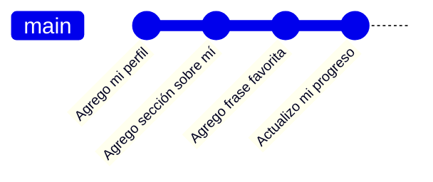
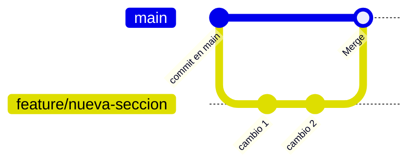
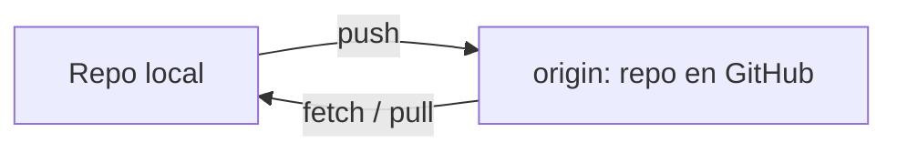
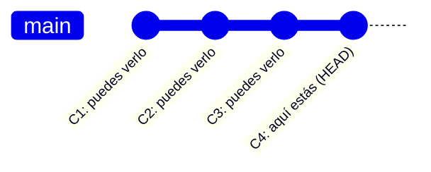
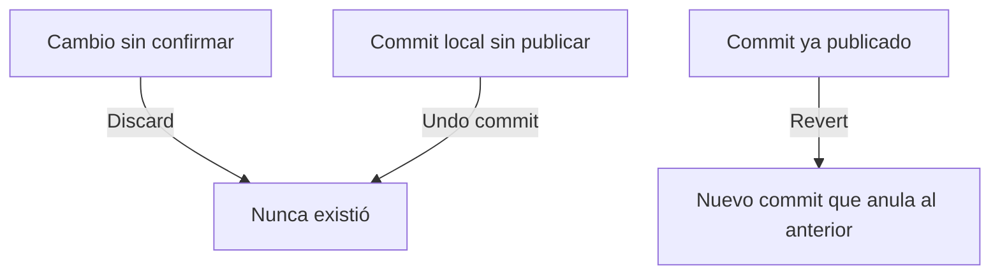
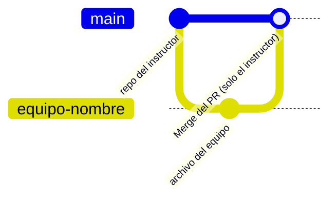
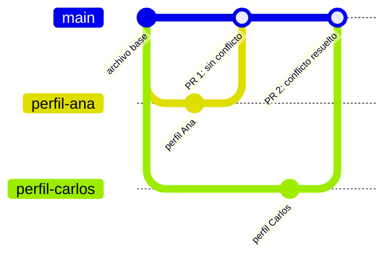

# Guion de clase: Git y GitHub para principiantes
## Etapa 1 · GitBasic: 1 sesión de 4 horas (intensiva)

> Formato de la clase: **cero código en pantalla**. Todo se enseña navegando interfaces gráficas: **GitHub Desktop**, **GitHub.com** y **Visual Studio Code** (con extensiones). La terminal no se usa en este bloque; queda como reto opcional de autoestudio y como puente al Bloque 2. El hilo conductor de la sesión es un archivo Markdown personal (`mi-perfil.md`) que el alumno construye poco a poco y que sirve como materia prima para cada commit.

---

## 0. Filosofía del guion (léelo antes de dar la clase)

Cada escena existe para generar una pregunta que **solo la siguiente escena resuelve**: primero se entiende qué es un commit, luego se trabaja **en local** (commits, ramas, merge) antes de tocar la nube, después se sube todo a GitHub (push) y se aprende a recibir (fetch/pull), se aprende a mirar y a deshacer, y **solo entonces** se trabaja con otras personas. El conflicto ya no se provoca en una escena aislada: aparece solo, de forma natural, en el proyecto final en equipo, que es donde un conflicto tiene sentido.

Dos decisiones de diseño que conviene tener presentes:

- **Local primero, nube después.** El alumno crea su repo desde GitHub Desktop, en su disco, y lo publica hasta la Escena 6. Así la frase "Git vive en tu compu, GitHub es solo la casa en internet" se experimenta, no solo se escucha.
- **GitHub.com como ventana, no como editor.** En las escenas individuales GitHub.com solo se usa para verificar que las cosas llegaron. Se vuelve protagonista hasta la colaboración (fork, colaboradores, Pull Requests, resolución de conflictos).

**Recomendación crítica:** verifica en los primeros 2 minutos que **todos** los alumnos ya tienen cuenta de GitHub, GitHub Desktop vinculado y las extensiones instaladas (ver Acto 0). Si alguien no las tiene, sepáralo con un asistente; no pauses al grupo completo.

### Mapa general (storyboard): ~250 minutos

| # | Escena | Tema del temario | Duración | Herramienta protagonista |
|---|--------|-------------------|----------|--------------------------|
| - | Acto 0 | Preparación previa | (antes de clase) | - |
| 1 | Escena 1 | Introducción: ¿qué pasa sin Git? + Markdown #1 | 15 min | Presentación (Canva) + VS Code |
| 2 | Escena 2 | Tour de GitHub Desktop + Markdown #2 | 15 min | GitHub Desktop |
| 3 | Escena 3 | Conceptos: repo, commit, rama + Markdown #3 | 10 min | GitHub Desktop |
| 4 | Escena 4 | Nace tu repo local + primeros commits | 25 min | GitHub Desktop + VS Code |
| 5 | Escena 5 | Ramas y merge local + Markdown #4 | 35 min | GitHub Desktop + VS Code |
| - | - | *Descanso* | 10-15 min | - |
| 6 | Escena 6 | Push, Fetch y Pull + Markdown #5 | 20 min | GitHub Desktop + GitHub Web |
| 7 | Escena 7 | Viajar en el historial (solo mirar) | 10 min | GitHub Desktop + GitLens + Git Graph |
| 8 | Escena 8 | Si algo sale mal: los botones de deshacer | 10 min | GitHub Desktop |
| 9 | Escena 9 | Fork + colaboradores + Pull Request | 30 min | GitHub Web + GitHub Desktop |
| 10 | Escena 10 | Proyecto final: perfiles en equipo + conflictos reales | 50 min | GitHub Web + GitHub Desktop + VS Code |
| - | - | Cierre y recursos | 20 min | - |

**Suma de control:** 15+15+10+25+35+10+20+10+10+30+50+20 = 250 min (255 si el descanso es de 15). Si el grupo va atrasado, los primeros recortes recomendados son, en este orden: las actividades Markdown #2 y #3 (dictarlas en vez de escribirlas), la Escena 7 (dejar solo History de Desktop), y el Paso 9 de la Escena 10 (feedback a otro equipo).

---

## Acto 0: Preparación previa (antes de la clase)

1. Cuenta de GitHub creada y **correo verificado** por cada alumno antes de llegar (no se necesita el Student Developer Pack).
2. Instalados previamente: **Git**, **GitHub Desktop** (con la cuenta ya vinculada) y **Visual Studio Code**.
3. Extensiones de VS Code ya instaladas antes de clase (no se instalan en vivo): **GitLens** y **Git Graph**.
4. Repositorio del instructor listo en GitHub con:
   - la carpeta `answers-box/` (con un archivo de ejemplo, p. ej. `equipo-dinamita.md`),
   - `main` protegido con revisión obligatoria de **code owner** (el instructor), para que los PRs de los equipos solo los pueda aprobar y mergear él.
5. URL del repo del instructor lista para compartir en pantalla o en el chat al llegar a la Escena 9.
6. Equipos armados de antemano (3-4 personas) con un **líder** designado por equipo: ahorra minutos en la Escena 9.

---

### 🎬 Escena 1: "¿Qué pasa sin Git?" (15 min)

**Objetivo:** entender el problema que resuelve el control de versiones y la diferencia Git/GitHub, y tener listo el archivo que acompañará toda la sesión.

**Gancho de apertura (2 min):** *"¿Alguna vez tuvieron un archivo llamado `final_v2_definitivo_YA.docx`? Hoy lo van a reemplazar."*

**Guion:**

1. (6 min) Presentación: qué es el control de versiones, Git = fotografías con memoria de tu proyecto, guardadas en tu computadora; GitHub = la casa en internet donde viven esas fotografías y donde otros pueden verlas y colaborar. Por qué empezamos con **GitHub Desktop**: para *ver* lo que Git hace por dentro.
2. (7 min) **Actividad Markdown #1:** en VS Code crean `mi-perfil.md` en el Escritorio (encabezados, listas, cita). Todavía no hay Git: es solo un archivo. Frase clave: *"Guárdenlo bien, este archivo va a ser la materia prima de todos sus commits de hoy."*

**Transición:** *"Ese archivo existe, pero nadie lo está vigilando. Vamos a conocer la herramienta que lo va a vigilar."*

---

### 🎬 Escena 2: Tour de GitHub Desktop (15 min)

**Objetivo:** que el alumno ubique las cinco zonas de la interfaz antes de necesitarlas.

**Guion:**

1. (8 min) Tour en vivo: **Current Repository**, **Current Branch**, **Changes**, **History**, **Publish / Push origin**. Si alguien no vinculó su cuenta: `File → Options → Accounts → Sign In`.
2. (7 min) **Actividad Markdown #2:** agregan a `mi-perfil.md` una tabla de herramientas del curso, negritas y código en línea.

**Transición:** *"Ya saben dónde están los botones. Antes de presionarlos, tres palabras que van a escuchar todo el día."*

---

### 🎬 Escena 3: Repo, commit y rama (10 min)

**Objetivo:** fijar el vocabulario mínimo.

**Guion:**

1. (5 min) Tres conceptos, mostrados sobre el History de un repo en Desktop: **repositorio** (una carpeta que Git vigila), **commit** (una fotografía con autor, mensaje y *hash*), **rama** (una línea de tiempo alterna).
2. (5 min) **Actividad Markdown #3:** agregan la sección "Mi progreso en el curso" con casillas `- [ ]`. Irán marcándolas durante la clase.

**Transición:** *"Ya tienen el vocabulario. Ahora sí: vamos a hacer que Git vigile su archivo."*

---

### 🎬 Escena 4: Nace tu repo local + primeros commits (25 min)

**Objetivo:** crear un repositorio **en local** y ver crecer su historial commit a commit.

**Guion:**

1. (7 min) En Desktop: `File → New Repository` → **Name** (`mi-proyecto-git`) → **Local Path** (Escritorio) → `Create Repository`. Advertencia importante: Desktop **siempre crea una carpeta nueva** con ese nombre; si eligen una carpeta existente como Local Path, terminan con una carpeta dentro de otra.
2. (5 min) Con el Explorador de archivos (o Finder) mueven `mi-perfil.md` dentro de la carpeta nueva. Aprovecha para mostrar que es **una carpeta normal**: activa "Elementos ocultos" (Windows) o `Cmd+Shift+.` (Mac) y señala la carpeta `.git`. Frase clave: *"Ahí adentro vive toda la magia. No hay ningún servidor escondido: es tu disco."*
3. (5 min) Primer commit: en **Changes** aparece el archivo → casilla marcada → **Summary**: `Agrego mi perfil` → **Commit to main** → verlo en **History**.
4. (8 min) Ejercicio: agregar contenido y repetir hasta tener **3 o 4 commits**. Mostrar cómo crece el historial.

**Diagrama:**

**Transición:** *"Todo está en una sola línea de tiempo. ¿Qué pasa si quiero probar algo sin tocar la versión que ya funciona?"*

---

### 🎬 Escena 5: Ramas y merge local (35 min)

**Objetivo:** ver dos líneas de tiempo separadas y volver a juntarlas, todo en local.

**Guion:**

1. (5 min) Analogía: `main` es la carretera; una rama es un desvío que nace en un punto exacto y tiene sus propias paradas.
2. (5 min) Crear rama: **Current Branch → New Branch** → `feature/nueva-seccion` → `Create Branch`. Si aparece el diálogo de cambios sin commit, explicar las tres opciones (**Leave my changes**, **Bring my changes**, **Stash changes**) y pedir que elijan *Leave* para este ejercicio.
3. (12 min) **Actividad Markdown #4 dentro de la rama:** sección de recursos con links y lista numerada de dudas. Commit en la rama. Cambiar a `main` y mostrar que ahí **no** está esa sección; volver a la rama y reaparece.
4. (13 min) **Merge local:** parados en `main` → `Branch → Merge into Current Branch` → elegir `feature/nueva-seccion` → `Create a merge commit`. Ver en **History** cómo se unen los caminos.

> Nota de orden: la actividad #4 debe hacerse **antes** del merge. En el README del alumno aparece después del paso de merge; indícalo en voz alta para que nadie mergee con la rama vacía.

**Diagrama:**

**Transición:** *"Todo esto vive solo en su compu. Si hoy se les descompone la laptop, se pierde. ¿Cómo lo mandamos a la nube?"*

**→ Descanso: 10-15 min**

---

### 🎬 Escena 6: Push, Fetch y Pull (20 min)

**Objetivo:** subir el repo local a GitHub y entender las tres operaciones de sincronización.

**Guion:**

1. (5 min) **Actividad Markdown #5** antes de subir: sección de reflexión con separadores `---` y cursiva. Commit.
2. (7 min) **Publish repository** → público o privado → el botón cambia a **Push origin**. Abrir GitHub.com y mostrar el repo y `mi-perfil.md`: momento de mayor impacto visual, no lo apures. GitHub.com aquí es solo para **verificar**, no para editar.
3. (5 min) Presentar la tabla Push / Fetch / Pull con la analogía del buzón: *"Fetch es mirar el buzón; Pull es meter las cartas a tu escritorio."* Mencionar que **origin** es el apodo que Git le da a la copia en GitHub.
4. (3 min) Un commit más y **Push origin** para fijar el músculo.

**Diagrama:**

> El Pull de verdad (recibir algo que otra persona subió) no se practica aquí: se practica en la Escena 9, cuando un compañero suba algo.

**Transición:** *"Ya tienen historia, en local y en la nube. Antes de trabajar con otros, dos habilidades de supervivencia: saber mirar el pasado y saber deshacer."*

---

### 🎬 Escena 7: Viajar en el historial (10 min)

**Objetivo:** inspeccionar el pasado sin miedo a romper el presente. En este bloque **solo se mira**: no se hace checkout de commits antiguos.

**Guion:**

1. (3 min) **History** en Desktop: clic en cualquier commit, verde = agregado, rojo = quitado.
2. (3 min) **GitLens** en VS Code: pasar el cursor sobre una línea de `mi-perfil.md` y ver quién la escribió y cuándo (*blame*).
3. (3 min) **Git Graph**: `Ctrl+Shift+P` → `Git Graph: View Git Graph`. Señalar la bifurcación y el merge de la Escena 5.
4. (1 min) Analogía de cierre: el historial es el control deslizante de un video; mirar no compromete nada.

**Diagrama:**

**Transición:** *"Ya sabemos mirar. ¿Y si el error fue hace 30 segundos? Ahí no queremos mirar, queremos deshacer."*

---

### 🎬 Escena 8: Si algo sale mal (10 min)

**Objetivo:** conocer el botón de deshacer correcto para cada momento.

**Guion:** presentar la tabla y demostrar los dos primeros en vivo.

| Situación | Qué usar | Dónde está |
|---|---|---|
| Guardaste pero **no hiciste commit** | **Discard changes** | Clic derecho sobre el archivo en *Changes* |
| Hiciste commit pero **no hiciste push** | **Undo commit** | Botón "Undo" justo después del commit (desaparece si navegas a otra pantalla) |
| Estás en medio de un merge con conflicto | **Abort merge** | Botón visible en Desktop durante el conflicto |
| El commit ya está en GitHub | **Revert commit** | Clic derecho sobre el commit en *History* |

Frase clave: *"Undo reescribe; Revert agrega. Cuando ya compartiste algo, Revert es siempre la opción segura."*

**Diagrama:**

**Transición:** *"Ya tienen todo lo necesario para trabajar solos. Ahora viene lo que de verdad se hace en la industria: trabajar sobre el repositorio de otra persona."*

---

### 🎬 Escena 9: Fork + colaboradores + Pull Request (30 min)

**Objetivo:** montar el espacio de trabajo del equipo y mandar el primer Pull Request al repo del instructor.

**Guion:**

1. (5 min) Teoría breve con dos ideas nuevas: **fork** (fotocopiar un libro para poder subrayarlo sin tocar el original) y **Pull Request** (una solicitud formal que abre una conversación, no un push a la fuerza). Pregunta guía: *"¿por qué no simplemente hago push al repo del instructor?"*: porque nadie tiene permiso de escribir directo en el repo de otro.
2. (8 min) **Solo el líder:** `Fork` del repo del instructor → en su fork, `Settings → Collaborators → Add people` con cada compañero → clona su fork en Desktop. Los compañeros aceptan la invitación del correo.
3. (4 min) **El resto:** `File → Clone Repository → URL` con la URL del fork del líder.
4. (7 min) **Primer Pull real:** el líder crea la rama `equipo-[nombre]`, crea `answers-box/equipo-[nombre].md`, commit y Push. Los compañeros hacen **Fetch origin** y se cambian a esa rama desde **Current Branch**: el archivo aparece en su VS Code. Frase clave: *"Fetch les avisó que la rama existe; al cambiarse a ella, se la trajeron."*
5. (4 min) El líder hace **Create Pull Request** desde Desktop. Verificar en el navegador: base `instructor/GitBasic ← main`, head `tu-usuario/GitBasic ← equipo-[nombre]`. Señalar que no ven botón de merge: `main` del instructor está protegido por code owner.
6. (2 min) Cada equipo deja un comentario en el PR de otro equipo.

**Diagrama:**

**Transición:** *"Hasta ahora solo el líder escribió. ¿Qué pasa cuando todos escriben en el mismo archivo al mismo tiempo?"*

---

### 🎬 Escena 10: Proyecto final, perfiles en equipo + conflictos reales (50 min)

**Objetivo:** integrar todo en un flujo de equipo con PRs internos, y vivir un conflicto que surge solo.

**Guion:**

1. (5 min) El líder escribe la **estructura base** del archivo del equipo (integrantes, perfiles, tres preguntas con `*Responde: [nombre]*`, aprendizajes, pregunta pendiente). Commit y Push.
2. (5 min) Los demás: Fetch → cambiarse a `equipo-[nombre]`. Cada integrante crea su rama `perfil-[su-nombre]` **desde** `equipo-[nombre]`.
3. (10 min) Cada quien agrega su perfil y responde **una pregunta distinta**. Commit (`Agrego perfil de [nombre]`) y Push.
4. (5 min) Cada integrante abre en GitHub.com un PR **dentro del fork**: base `equipo-[nombre]` ← compare `perfil-[su-nombre]`.
5. (15 min) El líder mergea uno por uno. El primero entra limpio; **a partir del segundo aparece el conflicto**. Resolver con **Resolve conflicts** en GitHub.com: explicar `<<<<<<<` / `=======` / `>>>>>>>`, **conservar ambas secciones**, borrar marcadores, **Mark as resolved → Commit merge**. Analogía: *"dos borradores del mismo párrafo; aquí nos quedamos con los dos."* Botón de pánico: cerrar el PR sin mergear, nada se pierde.
6. (7 min) PR final de `equipo-[nombre]` al repo del instructor (verificando base y head como en la Escena 9).
7. (3 min) Comentario en el PR de otro equipo.

> Nota técnica: en el Paso 8 del README se pide **Fetch origin** "para traer los merges"; Fetch no actualiza los archivos locales, solo avisa. Para el PR final da igual (el PR se arma con lo que ya está en GitHub), pero si alguien quiere ver los perfiles en su VS Code necesita **Pull origin**. Aclararlo en voz alta refuerza la analogía del buzón.

**Diagrama:**

*(En el diagrama, `main` representa la rama `equipo-[nombre]` del fork.)*

---

## Cierre y recursos (20 min)

- Recorrer el repo del instructor en GitHub.com cuando los PRs ya estén mergeados: la carpeta `answers-box/` con los archivos de **todos los equipos** es la foto final del trabajo colectivo.
- Una frase por escena, recorriendo el Git Graph del fork de un equipo: "esa rama fue la Escena 5, ese PR fue la Escena 9, ese conflicto fue la Escena 10...".
- Presentar el **autoestudio** ([`material/autoestudio-1.md`](../material/autoestudio-1.md)), en especial el Reto 5 (terminal y GitHub CLI): es el puente directo a la Etapa 2 (GitFlow), que será 100% en terminal.
- Recursos: GitHub Learning Lab, Oh My Git!, Pro Git en español, Markdown Guide.
- Preguntas abiertas.

---

## Notas finales para el instructor

- Esta sesión no tiene colchón real: si una escena se atrasa 5 minutos, recórtalos de inmediato según el orden sugerido en el mapa general.
- Las escenas 9 (fork + PR) y 10 (conflictos) son las de mayor riesgo pedagógico: la primera depende de que los compañeros **acepten la invitación** a tiempo (pídeselo desde el inicio de la escena) y la segunda es el clímax emocional (perder el miedo al conflicto). No las recortes.
- Temas que **no** entran en esta etapa y pasan a la Etapa 2 (GitFlow): terminal, local vs. origin a fondo, protección de ramas configurada por ellos mismos, issues, rebase, force push y automatización.
