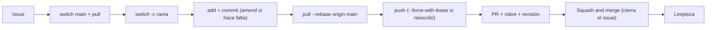

<div align="center">

# Autoestudio 3: ciclo completo sin red

Etapa 2 del curso de Git · GitFlow · En equipo · ~2 horas

<br>


&nbsp;&nbsp;&nbsp;&nbsp;


</div>

---

**Requisito:** haber terminado el Bloque 7 de GitFlow. El repo del equipo tiene sus reglas (solo squash, ruleset `proteger-main` y el robot), y cada quien sabe ponerse al día con `pull --rebase` y resolver un conflicto.

## ¿Por qué este autoestudio?

En clase hicieron todo con alguien guiándolos paso a paso. La pregunta real es otra: **mañana, solos, frente a un repo de equipo, ¿saben qué hacer primero?** Aquí van a repetir el ciclo completo **sin instrucciones paso a paso**, solo con el [acordeón del ritual](guia-alumno.md#acordeón-el-ritual-de-trabajo-en-equipo), que está al final de la guía. Nadie los guía: si se atoran, primero el acordeón, después su equipo y al final el instructor.

> Es una actividad aparte de la tarea "Nuestras reglas del juego". Háganla **antes** de la tarea: la tarea también se escribe con issues, ramas y PRs, y llegar con el ciclo dominado la hace mucho más rápida.

---

## Antes de empezar

- [ ] Todos, en el repo del equipo: `git switch main`, `git pull` y `git status` sin nada pendiente.
- [ ] `gh pr list` no muestra PRs abiertos de clase. Si hay alguno, intégrenlo o ciérrenlo primero.
- [ ] Cada quien tiene el acordeón abierto (o impreso).
- [ ] Acuerden un horario: pueden trabajar al mismo tiempo, cada quien en su compu, o cada uno a su ritmo durante la semana.

## Cómo entregar

El **historial del repo** es la entrega: issues cerrados, PRs revisados y la historia de `main`. Además, al final suben una bitácora del equipo en `docs/soporte/autoestudio-3.md`, también por PR.

---

## Reto 1 — Una tarea para otra persona

Cada quien crea un issue **para otra persona** del equipo, de modo que a todos les toque uno. Por ejemplo, Ana para Luis, Luis para Sofía, Sofía para Ana.

- **Plantilla:** Tarea.
- **Título:** `Agregar recomendación de [nombre de tu compañero]`.
- **¿Qué hay que hacer?:** agregar el archivo `recomendaciones/[su-nombre].md` con el formato de abajo.
- **¿Cuándo está terminado?:** cuando el archivo esté en `main`.
- **Asignado a:** tu compañero, no tú.

En la web, o desde la terminal:

```bash
gh issue create --assignee usuario-del-compañero
```

Después, cada quien busca el suyo:

```bash
gh issue list --assignee @me
```

**El archivo que pide el issue:**

```markdown
# Recomendación de [nombre]

**Qué es:** libro / video / canal / curso
**Título:**
**Enlace:** [abrir](https://...)

## Por qué lo recomiendo

```

**Autoverificación:**

| Debieron lograr | Cómo lo confirman |
|---|---|
| Un issue por integrante, cada uno asignado a otra persona | En **Issues**, cada issue tiene un *assignee* distinto de quien lo creó |
| Cada quien encontró el suyo desde la terminal | `gh issue list --assignee @me` muestra exactamente uno |

---

## Reto 2 — El ciclo completo, solo con el acordeón

Cada quien resuelve el issue que le asignaron, de principio a fin, **sin volver a la guía paso a paso**:



Puntos donde casi todos se equivocan la primera vez:

- La rama nace de un `main` **recién actualizado**, y lleva el número del issue: `feature/[número]-recomendacion-[tu-nombre]`.
- El **título del PR** sigue la convención (`docs: agrego mi recomendación`): es lo que quedará escrito en `main`.
- Si `main` avanzó mientras trabajabas, ponte al día con `git pull --rebase origin main` (o solo `git pull`, si configuraste `pull.rebase true`) y sube con `git push --force-with-lease`. **No uses el botón *Update branch*.**

**Autoverificación:**

| Debieron lograr | Cómo lo confirman |
|---|---|
| Cada quien hizo el ciclo completo | Cada integrante tiene un PR integrado con `Closes #` de su issue |
| Nadie usó *Update branch* ni dejó un merge en su rama | Ningún PR muestra un commit *"Merge branch 'main' into ..."* |
| El robot pasó en todos | Cada PR tiene la palomita verde de **Sin marcadores de conflicto** |

---

## Reto 3 — Revisión cruzada

Cada PR lo revisa alguien que **no** creó el issue ni escribió el archivo:

1. **Files changed:** lee el archivo completo.
2. Deja al menos **un comentario en una línea** (el `+` azul).
3. **Review changes → Approve**, solo si el archivo cumple lo que pedía el issue.

Cuando el PR tenga aprobación, el **autor** lo integra con **Squash and merge**, leyendo antes la caja del mensaje: título convencional y `(#número)`.

**Autoverificación:**

| Debieron lograr | Cómo lo confirman |
|---|---|
| Ningún autor aprobó su propio PR | En cada PR, quien aprobó es distinto de quien lo abrió (GitHub no deja hacerlo, pero confírmenlo) |
| Cada revisión dejó un comentario en una línea | En **Files changed** de cada PR hay al menos un comentario |

---

## Reto 4 — Limpieza final

Cada quien, al terminar:

```bash
git switch main
git pull
git branch          # solo debe quedar main (si queda alguna rama con PR integrado: git branch -D)
git fetch --prune
```

Y el equipo, en GitHub.com: la pestaña **Issues** no tiene nada abierto de este autoestudio, y la pestaña **Pull requests** no tiene nada abierto.

---

## Reto 5 — La prueba de la historia

```bash
git log --oneline
```

Lean la historia de `main` de arriba hacia abajo, en voz alta. **Desde el Bloque 5, cada línea debe ser un PR**, con título convencional y su `(#número)`. Abajo, antes de las reglas, quedan los nudos y los *"Merge pull request ..."* de los perfiles.

Si encuentran un *"ya ahora sí"* o un *"Merge branch ..."* en la zona de arriba, algo del ritual se saltó. Encuentren qué fue: es lo más valioso de la bitácora.

**Autoverificación:**

| Debieron lograr | Cómo lo confirman |
|---|---|
| Una línea por PR desde el Bloque 5 | `git log --oneline` |
| Cada línea lleva a su PR | Elijan una línea y ábranla: `gh pr view [número] --web` |

---

## Entregable — Bitácora del Autoestudio 3

Súbanla en `docs/soporte/autoestudio-3.md`, por PR (con el mismo ritual):

```markdown
# Autoestudio 3 — Equipo [nombre]

## Quién hizo qué

| Issue | Lo creó | Asignado a | PR | Lo revisó | Lo integró |
|---|---|---|---|---|---|
| # | | | # | | |

## Lo que consultamos en el acordeón
(Qué filas usaron y en qué momento se atoraron)

## La prueba de la historia
(¿Cada línea desde el Bloque 5 es un PR? Si encontraron algo raro, qué fue y qué paso del ritual se saltó)

## Reflexión

**¿Qué paso del ritual fue el más fácil de olvidar sin la guía?**


**¿Qué regla del repo los salvó de un error, o los habría salvado?**


**Una pregunta que les quedó pendiente:**

```
