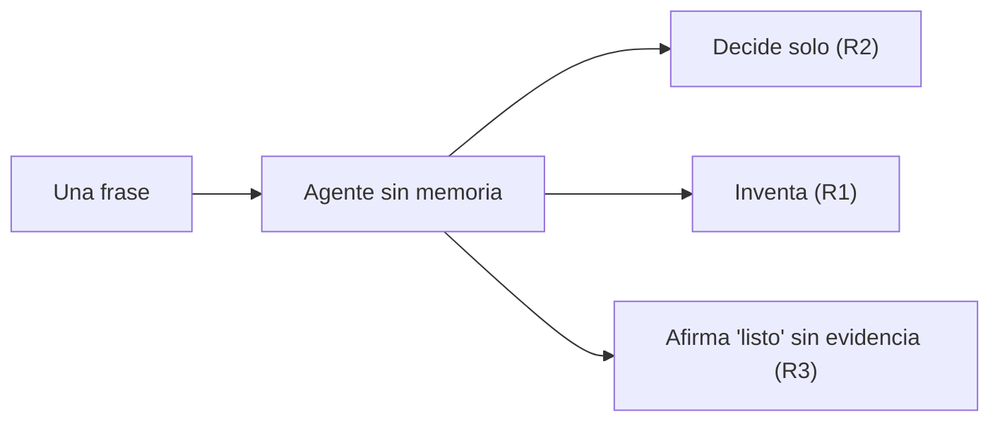
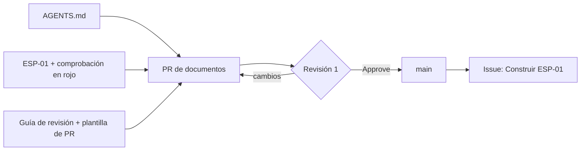
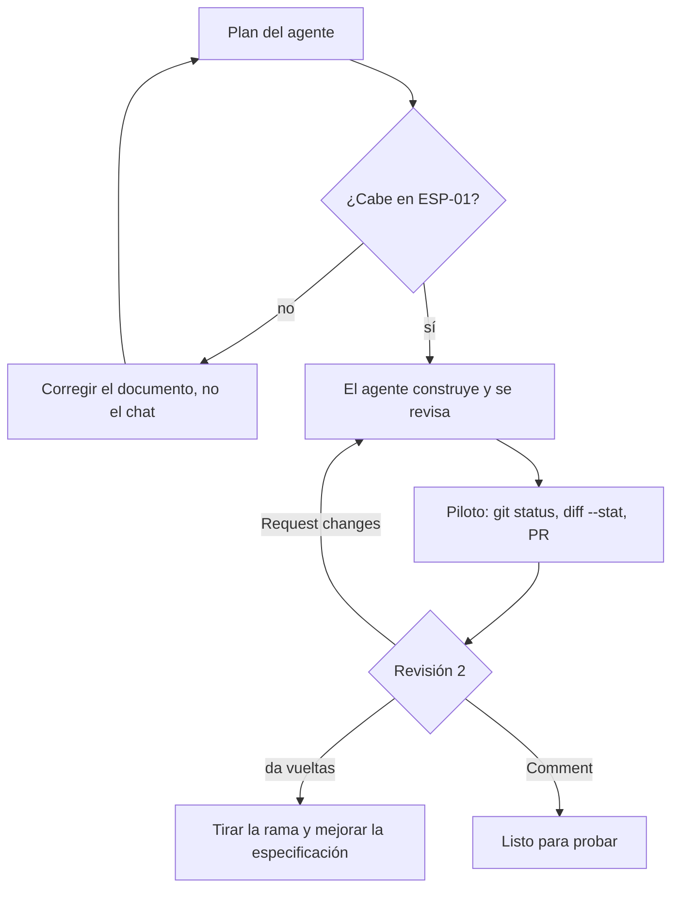
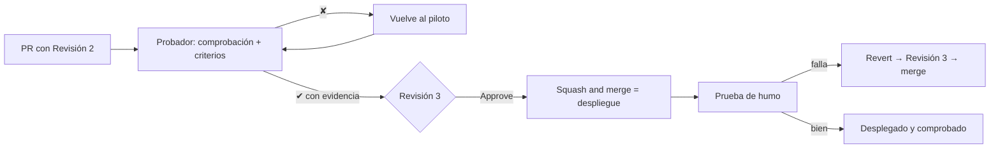

<div align="center">

# Guion de clase: construir software con un agente

Etapa 3 del curso de Git · AgenticFlow · 1 sesión de 4 horas + autoestudios + proyecto final · Material del instructor

<br>


&nbsp;&nbsp;&nbsp;&nbsp;


</div>

---

> Formato de la clase: **el agente no es el tema; el ciclo sí.** Se usa cualquier agente de código que lea el repo, lo cambie y ejecute comandos pidiendo permiso; el material habla de "el agente" y de `AGENTS.md`, y nada depende de una herramienta. Lo que el equipo **escribe** son documentos en Markdown. El código (HTML y CSS de la página del equipo) lo escribe el agente; los alumnos lo **especifican, lo revisan, lo prueban y lo despliegan**. Todo entra al repo con el ritual de GitFlow (issue, rama, PR, reglas de `main` y squash). Ese ritual no se vuelve a enseñar: se usa, y se explica por qué es lo que ordena el trabajo de un agente.

---

## <font color="#179287">0. Filosofía del guion (léelo antes de dar la clase)</font>

### La conclusión de la etapa

Todo en esta etapa apunta a una sola conclusión, que los alumnos deben poder repetir y, sobre todo, ejecutar solos al terminar:

```text
Documentar → Revisión 1 → Implementar → Revisión 2 → Probar → Revisión 3 → Desplegar
```

**Saber construir los documentos que guían al agente, revisarlos de forma organizada, implementar con el agente, revisar la implementación de forma organizada, probar, revisar las pruebas de forma organizada y desplegar.** La sesión recorre el ciclo una vez con algo pequeño (la página del equipo); el Autoestudio 5 lo recorre sin guía; el proyecto final lo recorre con el proyecto de cada equipo hasta dejarlo desplegado. Ese proyecto desplegado es lo que los equipos presentan en la **siguiente etapa**, a un grupo de ingenieros egresados y con experiencia en el sector que les dan mentoría.

La lógica interna es la de las etapas anteriores: cada bloque abre una pregunta que solo el siguiente resuelve. Primero se ve qué hace el agente sin nada escrito y qué riesgos aparecen solos (Bloque 1). Eso pide un lugar donde escribirle cómo es la casa (Bloque 2). Eso no le dice qué construir, y lo resuelve la especificación, que alguien revisa antes de que nadie cocine (Bloque 3). Solo entonces el agente implementa, y alguien revisa lo que hizo (Bloque 4). Al final, alguien que no lo construyó lo prueba, otro aprueba las pruebas y se despliega (Bloque 5).

### Siete decisiones de diseño

- **Lo que no está escrito, el agente lo inventa.** Es la idea que abre la clase y se repite cada vez que el agente decide algo solo. No se presenta como un defecto del agente, sino como un hueco del equipo.
- **"¿Cómo lo sé?" sustituye a "¿dónde está esto?".** Cada afirmación del agente, de un documento o de un alumno se verifica con algo visible: la salida de un comando, un archivo o la página en el navegador. La palabra del agente nunca cuenta como evidencia.
- **Revisión organizada quiere decir tres cosas:** cada revisión tiene **una lista** (la guía de revisión), la hace **alguien que no construyó** y queda **registrada en el PR**. Para eso existen cuatro papeles (piloto, revisor, probador y líder) y una regla: *quien construye no prueba ni aprueba su propio trabajo*.
- **GitFlow es lo que ordena la velocidad del agente.** Un agente escribe en una tarde lo que el equipo revisaría en un mes. Issue, rama, PR, reglas de `main`, robot, squash y revert son exactamente las herramientas que convierten ese volumen en avance. La etapa no las vuelve a enseñar: les da su propósito definitivo.
- **Cada riesgo, en su momento.** El Bloque 1 deja ver los riesgos de trabajar con IA; cada bloque siguiente mitiga los suyos, y el cierre los pone sobre el ciclo. La idea que se repite: *un riesgo se mitiga en el momento más temprano en que cuesta poco*. En un documento cuesta una línea; en producción, una reversa.
- **Un paso del ciclo por bloque, y un solo teclado por equipo.** El piloto teclea y el equipo decide; así se evitan esperas y conflictos sobre el mismo archivo, que en GitFlow fueron lo que más tiempo costó.
- **Los casos reales son evidencia, no anécdota.** Cada bloque se apoya en lo que pasó en tres proyectos construidos con agentes. Dos se presentan sin nombre (**Proyecto A** y **Proyecto B**) y **sin pistas de su dominio**. El tercero es **FILEY**, el sistema de registro de la Feria Internacional de la Lectura Yucatán, y solo se usa como ejemplo de buen trabajo. El detalle está en la [lectura de apoyo](../material/lecturas/documentacion-para-agentes.md) y en el Anexo.

**La analogía de la etapa continúa la cocina de GitFlow.** Allí el issue era la **comanda** y `main` era *"la mesa donde se sirve, no la tabla donde se corta"*. Ahora llega un **cocinero brillante sin memoria**: cocina rapidísimo, llega cada día sin recordar nada y nunca dice "no sé". `AGENTS.md` es el **recetario de la casa**. La especificación es la **receta del platillo**, y alguien la revisa antes de cocinar. La comprobación es **probar el platillo antes de servirlo**, y la prueba la hace alguien que no cocinó. Desplegar es **servirlo**: desde que `main` se publica, la mesa es pública, y nada llega a ella sin las tres revisiones.

**Recomendación crítica:** en los primeros 10 minutos verifica que **cada equipo tiene al menos un agente que lee su repo** (Apertura). Un equipo sin agente se junta con otro para los pasos que lo necesitan, sin detener al grupo.

### Mapa general (storyboard): ~225 minutos de trabajo + 15 de descanso

| # | Bloque | Paso del ciclo | Pregunta que responde | Duración | Acumulado |
|---|--------|----------------|-----------------------|----------|-----------|
| - | Acto 0 | - | Preparación previa | (antes de clase) | - |
| - | Apertura | - | ¿Funciona el agente en cada equipo? ¿Quién hace qué? | 10 min | 10 min |
| 1 | Un cocinero sin memoria | Antes del ciclo | ¿Qué hace un agente sin nada escrito, y qué riesgos aparecen? | 40 min | 50 min |
| 2 | El recetario de la casa | Documentar | ¿Dónde le escribimos cómo es la casa? | 40 min | 90 min |
| 3 | La receta, y la primera revisión | Documentar · Revisión 1 | ¿Cómo le decimos qué construir, y quién lo revisa antes de cocinar? | 40 min | 130 min |
| ☕ | Descanso | | | 15 min | (no incluido) |
| 4 | El agente implementa, y la segunda revisión | Implementar · Revisión 2 | ¿Cómo dejamos que construya sin perder el control? | 45 min | 175 min |
| 5 | Probar, la tercera revisión y desplegar | Probar · Revisión 3 · Desplegar | ¿Cómo sabemos que lo que se sirve es lo que pedimos? | 40 min | 215 min |
| - | Cierre | - | ¿Qué se llevan, y qué sigue? | 10 min | 225 min |

**Suma de control:** 10 + 40 + 40 + 40 + 45 + 40 + 10 = 225 min de trabajo, más 15 de descanso = 240 min.

**De dónde salen estos tiempos:** el guion no se ha dado todavía. Los tiempos se estimaron con el ritmo medido en GitFlow (octubre de 2026), donde los pasos prácticos tomaron **unas 3 veces** lo que tarda teclearlos, y se suma la espera de las respuestas del agente. Es un plan apretado: anota los tiempos reales para calibrarlo.

**Puntos de corte:** el final del Bloque 3 es el más seguro: los documentos están integrados y revisados. Al final del Bloque 4 el PR de implementación queda abierto y revisado, que también es un estado estable. **No** cortes a mitad de una revisión ni entre el merge y la prueba de humo del Bloque 5. Si la sesión se acaba antes del Bloque 5, ese bloque pasa a ser el primer paso del [Autoestudio 4](../material/autoestudio-4.md), que ya lo contempla.

**Si el grupo va atrasado,** los recortes recomendados son, en este orden: la explicación del Revert en el Bloque 5 (~4 min; se practica en el Autoestudio 5), la entrevista al agente del Bloque 2 (de 5 a 2 min: una sola pregunta) y la evidencia de proyectos reales del Bloque 1 (de 6 a 3 min). **No se recorta ninguna de las tres revisiones**: son la conclusión de la etapa. Si hay que elegir, es mejor terminar con el PR revisado y sin desplegar que desplegar sin revisar.

---

## <font color="#179287">Acto 0: Preparación previa (antes de la clase)</font>

**Del alumno (se pide con al menos una semana de anticipación):**

1. El **repositorio del equipo de GitFlow** al día, con `integrantes/` (un perfil por persona), las plantillas de issue y PR, el robot y las reglas de `main`.
2. **Al menos un agente por equipo**, instalado, con la sesión iniciada y probado **dentro del repo del equipo** (que responda con los archivos reales a *"¿Qué archivos hay en este repositorio?"*). Los [requisitos previos](../material/requisitos.md) comparan opciones gratuitas, económicas y estándar, y dicen cómo instalar cada una. Envíalos con al menos una semana de anticipación: el beneficio de estudiante de GitHub puede tardar días en activarse.
3. Los **papeles** decididos: piloto (quien tiene el agente), revisor, probador y líder. En equipos de tres, el líder es también el probador y la Revisión 3 la hace el revisor.
4. En Windows, saber abrir una terminal **Git Bash** en VS Code.
5. El documento de la tarea de GitFlow a la mano (`docs/soporte/workflow_y_politicas_de_trabajo_colaborativo.md`).

**Del instructor:**

1. Un **repo de demostración** con la misma forma que el de un equipo (README con tabla de integrantes y `integrantes/` con tres o cuatro perfiles) y un agente funcionando, para proyectar cada paso y para prestárselo a un equipo que se quede sin agente.
2. Haber hecho el recorrido completo una vez **con el mismo agente que vas a proyectar**, incluido un Revert: el experimento sin contexto cambia mucho de una herramienta a otra, y conviene saber qué va a pasar.
3. El material de la etapa ([`3-agenticflow/material/`](../material/)), con el enlace enviado por correo antes de la clase.
4. **Si un equipo nuevo no tiene repo de GitFlow:** que el líder lo cree con los pasos del Bloque 2 de GitFlow, con las reglas de `main` del Bloque 5, y que cada integrante suba su perfil por PR antes de la clase. Sin perfiles no hay datos para la página.

---

## <font color="#179287">Apertura (10 min)</font>

1. (5 min) **Check-in del agente.** Cada piloto abre su agente en el repo del equipo y pregunta *"¿Qué archivos hay en este repositorio?"*. Quien no tenga respuesta se va con un asistente o se junta con otro equipo.
2. (5 min) **El mapa del día.** Proyectar el ciclo completo y decir casi textual: *"Esto es lo que se van a llevar de esta etapa. Hoy lo recorremos una vez entero, con algo pequeño. Al final de la etapa lo van a recorrer solos con su propio proyecto, y lo van a presentar desplegado a ingenieros con experiencia."* Después, los cuatro papeles y su regla (*quien construye no prueba ni aprueba su propio trabajo*), la regla de permisos (**cada permiso se lee en voz alta y se decide; nadie usa "permitir siempre"**) y la pregunta del día: *¿cómo lo sé?*

---

### <font color="#F05032">Bloque 1: Un cocinero sin memoria (40 min)</font>

**Objetivo:** ver, en el repo del propio equipo, qué hace un agente cuando no tiene nada escrito, separar lo que decidió, inventó y afirmó sin evidencia, y nombrar los riesgos que aparecieron solos.

**Gancho de apertura (4 min):** proyecta la pregunta del reto final de GitBasic: *"¿Cómo puedes usar la IA en tu carrera sin perder el protagonismo?"*. *"Hace dos etapas la dejamos abierta. Hoy la contestamos con hechos."* Después, la cocina: *"En GitFlow, el issue era la comanda. Hoy llega a la cocina alguien nuevo: brillante, rapidísimo, que llega cada día sin recordar nada y nunca dice 'no sé'. Vamos a ver qué cocina si solo le decimos una frase."*

**Guion:**

1. (5 min) **Rama de experimento.** El piloto: `git switch main`, `git pull`, `git status` y `git switch -c experimento/sin-contexto`. *"Esta rama nunca sale de su compu."* Luego le pregunta al agente *"¿Qué archivos hay en este repositorio y para qué crees que sirve?"* y el equipo compara la respuesta con el explorador de VS Code.
2. (13 min) **La frase.** El piloto escribe solo esto: *"Haz una página web para presentar a nuestro equipo."* Mientras el agente trabaja, el resto llena la tabla de la Actividad 1. Si pide `git push`, cambiarse a `main` o borrar algo, se rechaza.
3. (8 min) **¿Cómo lo sé?** `git status` para ver qué creó, abrir la página en el navegador y contrastar cada afirmación del agente con lo que se ve. **Captura de pantalla obligatoria:** se compara en el cierre.
4. (6 min) **Los riesgos, con nombre.** Cada equipo busca en el acordeón de riesgos de la guía lo que vio: casi siempre aparecen *inventa* (R1), *decide solo* (R2), *"listo" sin evidencia* (R3) y, a veces, *dependencias que nadie decidió* (R9). Proyecta la evidencia de Proyecto A: un README que presumía *"100% testeado"* con 38 pruebas desglosadas, cuando el repo tenía 4, y enlaces a cuatro documentos que nunca existieron. Frase clave: *"Lo que no está escrito, el agente lo inventa. Y lo que inventa, lo afirma con la misma seguridad que lo que sabe."*
5. (4 min) **Guardar y salir.** `git add .`, `git commit -m "experimento: página sin contexto"`, `git switch main`. **Permisos** (Proyecto B, proyectado): una lista de permisos que se fue acumulando con "permitir siempre" hasta incluir `git push` y `git reset` con cualquier argumento. Frase clave: *"Lo que el agente ejecuta, lo firmas tú."*

**Si el agente hace una página impecable:** pasa a veces, y la lección se mantiene. Pregunta: *"¿Quién decidió los colores? ¿La tecnología? ¿Qué datos poner? ¿Era lo que el equipo quería, o lo que el agente supuso? ¿Y quién comprobó lo que dijo?"*

**Diagrama:**



**Transición:** *"El agente no es malo: le faltó todo lo que el equipo sabe y nunca escribió. Y mañana va a llegar sin recordar nada de hoy. ¿Dónde se lo escribimos para que lo lea cada vez que llegue?"*

---

### <font color="#F05032">Bloque 2: El recetario de la casa (40 min) · Documentar</font>

**Objetivo:** escribir en equipo el `AGENTS.md` del repo (corto, verdadero y en un solo lugar) y usar al agente como lector que encuentra huecos. Todavía no se integra: se revisa junto con la especificación en el Bloque 3.

**Guion:**

1. (8 min) **Qué es y tres reglas.** `AGENTS.md` es el archivo que el agente lee cada vez que empieza, antes de hacer nada. Retomar GitFlow: *"la configuración es un archivo, viaja con el repo y entra por PR"*. Las tres reglas:
   - **Es un mapa, no una enciclopedia.** Proyectar el inicio de las instrucciones de FILEY: la tabla *Dónde / Qué es* y *"La arquitectura la mandan `docs/adr/`; los detalles de cómo se construye una pantalla viven en los skills, no aquí."*
   - **Todo lo que dice es verdad hoy.** Volver al README de Proyecto A: un agente que lo leyera buscaría documentos que no existen.
   - **Una sola fuente.** Proyecto B tenía cuatro archivos de instrucciones que repetían lo mismo con variaciones. FILEY escribe en uno y genera las copias.

   Frase clave: *"El agente no recuerda: lo que necesita saber, lo lee cada vez. Y lo que lee, lo cree."*
2. (3 min) **El ritual de siempre.** Un issue, *Documentar la página del equipo*, que cubre los Bloques 2 y 3. Rama `feature/[número]-documentacion`.
3. (22 min) **Actividad 2.** El equipo copia la plantilla y la llena sección por sección. *Cómo trabajamos* sale de "Nuestras reglas del juego". Detente en **Lo que nunca se hace**: secretos (R8), dependencias no decididas (R9), despliegue e instrucciones escondidas en lo que lee (R12). *"Cada línea de esta sección es un riesgo mitigado en el momento más barato: antes de que el agente escriba una sola línea de código."* Pasea por los equipos con una sola pregunta: *"¿Cómo lo saben?"*
4. (5 min) **Entrevista al agente.** *"Lee AGENTS.md. No escribas ni cambies nada. Dime qué preguntas tendrías que hacernos antes de construir cualquier cosa en este repositorio."* Lo que es de todo el repo va a `AGENTS.md`; lo que es de la página se anota para la especificación. Frase clave: *"Sus preguntas son los huecos de su documentación."*
5. (2 min) **Guardar sin integrar.** Commit `docs: agrego AGENTS.md` y `git push -u` de la rama: *"que no viva solo en una compu, como aprendieron en GitFlow"*. El PR se abre en el Bloque 3.

**Transición:** *"El agente ya sabe dónde está y cómo trabaja el equipo. Lo que todavía no sabe es qué quieren que construya. ¿Le basta la comanda de GitFlow a alguien que lo toma todo al pie de la letra? ¿Y quién revisa lo que escribimos antes de que el agente lo obedezca?"*

---

### <font color="#F05032">Bloque 3: La receta, y la primera revisión (40 min) · Documentar y Revisión 1</font>

**Objetivo:** escribir la especificación de la página con criterios comprobables, dejar su comprobación lista **y en rojo**, instalar las herramientas de la revisión organizada y hacer la **Revisión 1** de todos los documentos antes de construir.

**Guion:**

1. (5 min) **Comanda contra receta.** El issue se cierra; la especificación se queda y el agente la lee cada vez. Dos errores reales: el plan de casi 2,400 líneas de Proyecto A, sin una línea migrada (*"un plan cuenta cómo pasar el tiempo; una especificación cuenta qué tiene que ser verdad al terminar"*), y el glosario y el caso de uso contradictorios de Proyecto B (*"si dos documentos dicen distinto, el agente elige uno sin avisar"*).
2. (17 min) **Actividad 3.** El equipo adapta el punto de partida de ESP-01. Lo que más cuesta es **convertir deseos en criterios**: *"Si no sabes cómo lo comprobarías, no es un criterio, es un deseo."* Las secciones **Decisiones ya tomadas** y **Fuera de alcance** son la mitigación de *decide solo* (R2) y *hace de más* (R5).
3. (4 min) **La comprobación, antes que la página.** Copiar `pruebas/verificar-sitio.sh` (revisar **LF**), correrla en Git Bash y leer: *"no hay index.html en la raíz del repositorio"*. Frase clave: *"La comprobación existe antes que la página. Así nadie la ajusta a lo que salió."*
4. (4 min) **Las herramientas de la revisión.** Copiar la guía de revisión (borrando las menciones a `docs/despliegue.md` y `docs/riesgos.md`, que todavía no existen) y la plantilla de PR nueva. Proyectar la tabla de las tres revisiones y su regla. *"Revisar no es 'darle una leída'. Es una lista, alguien que no lo escribió y un registro en el PR."*
5. (8 min) **Revisión 1 · Documentos.** PR `docs: documentación de la página del equipo (ESP-01)` con la salida en rojo en la descripción. El revisor copia la lista de la Revisión 1 en su revisión y la marca; *Approve* o *Request changes*. Squash y limpieza. Frase clave: *"Un error aquí cuesta una línea. El mismo error en el código cuesta una vuelta del agente, y en producción, una reversa."*
6. (2 min) **La comanda corta.** Issue *Construir ESP-01*, que apunta a la especificación. *"La comanda ahora es corta porque la receta ya está en la cocina, y ya la revisó alguien."*

**Diagrama:**



**Transición:** *"Ya está todo escrito y revisado. Ahora sí, que cocine. Pero el agente puede escribir en minutos lo que tardaríamos días en revisar. ¿Cómo lo dejamos trabajar sin perder el control?"*

**→ Punto de corte seguro:** documentos integrados y revisados, issue de construcción creado. Buen lugar para el descanso.

---

### <font color="#F05032">Bloque 4: El agente implementa, y la segunda revisión (45 min) · Implementar y Revisión 2</font>

**Objetivo:** que el agente construya ESP-01 con plan previo, en una rama y un PR del tamaño de una especificación, y que el revisor haga la **Revisión 2** con su lista.

**Guion:**

1. (3 min) **El ritual.** `git switch main`, `git pull`, `git switch -c feature/[número]-pagina-del-equipo`.
2. (7 min) **El plan antes que el código** (mitiga *trabajo demasiado grande*, R4). El equipo compara el plan con ESP-01. Frase clave: *"Si tienes que explicárselo en el chat, faltaba en el repo. Lo que dices en el chat se olvida al cerrar la sesión (R13); lo que escribes en la especificación, no."*
3. (12 min) **Que cocine.** El agente construye, corre la comprobación y se revisa con la lista de la Revisión 2. Los permisos se siguen leyendo en voz alta (R7).
4. (8 min) **El primer vistazo del piloto.** `git status` y `git diff --stat`: si tocó `pruebas/`, `integrantes/` o `.github/`, se descarta. Commits, `estado: construida` en ESP-01, push y PR con la plantilla nueva. **Cómo lo comprobé** se queda para el probador.
5. (12 min) **Actividad 4: Revisión 2 · Implementación.** El revisor, en **Files changed**, con la lista. Proyectar la evidencia mientras revisan: en Proyecto B, a un agente se le pidió un sistema completo de una vez; un commit de 15,134 líneas y un PR de 32,759 que **nunca recibió una revisión ni se integró**, y el equipo tuvo que abrir cuatro tareas solo para entender el código. Frase clave: *"Si no lo puedes explicar, no se integra."* (R10). *Comment* si todo está bien; *Request changes* si no, y el piloto se lo pasa al agente nombrando **la regla o el criterio**, no la solución.
6. (3 min) **Si da vueltas.** Después de dos o tres intentos, no se le persigue: en Proyecto B, 19 de los 28 commits que siguieron a la implementación gigante fueron correcciones. Se cierra el PR, se tira la rama y se mejora la especificación. *"La rama existe para esto: si el agente se pierde, main ni se entera."*

**Diagrama:**



**Transición:** *"El agente dice que terminó y el revisor ya leyó el código. ¿Ya lo servimos? Todavía no: nadie ha comprobado que lo que se va a servir es lo que se pidió."*

**→ Punto de corte aceptable:** PR abierto con su Revisión 2.

---

### <font color="#F05032">Bloque 5: Probar, la tercera revisión y desplegar (40 min) · Probar, Revisión 3 y Desplegar</font>

**Objetivo:** que alguien que no construyó pruebe cada criterio con evidencia, que otro apruebe las pruebas con la **Revisión 3**, desplegar con una prueba de humo y saber cómo se deshace.

**Guion:**

1. (19 min) **Actividad 5: las pruebas.** El probador trae la rama con `gh pr checkout [número]`, corre la comprobación en Git Bash, revisa cada criterio en el navegador y deja la tabla de evidencia en el PR. Frase clave: *"El agente dice 'listo'. ¿Cómo lo sabes?"* (R3). Si un criterio falla, vuelve al piloto nombrando el criterio, el revisor mira el cambio nuevo y el probador vuelve a probar.
2. (6 min) **Revisión 3 · Pruebas.** El líder (o el revisor, en equipos de tres) marca la lista con la tabla del probador a la vista. Lo esencial: evidencia en cada criterio y **nadie tocó `pruebas/`** (R6). *Approve*.
3. (2 min) **Integrar.** **Squash and merge**; limpieza.
4. (9 min) **Desplegar.** El líder activa GitHub Pages (**Settings → Pages → main / (root)**). Mientras se publica, frase clave: ***"Desde ahora, cada merge a `main` es un despliegue. Por eso las tres revisiones pasan antes del merge, nunca después."*** Prueba de humo en la dirección publicada y comentario *"Desplegado y comprobado"* en el PR.
5. (4 min) **Si algo falla en producción.** Mostrar en tu repo de demostración el botón **Revert** de un PR integrado: crea un PR que lo deshace, pasa por la Revisión 3 y se integra. *"Es el `git revert` de GitFlow, con botón. Nunca un arreglo directo en `main`."* (R14). Se practica completo en el Autoestudio 5.

**Diagrama:**



---

## <font color="#F05032">Cierre: el ciclo completo (10 min)</font>

### 1. Antes y después (2 min)

Cada equipo pone lado a lado la captura del Bloque 1 y la página publicada. *"El agente es el mismo. Lo que cambió fue todo lo que lo rodeó: lo que encontró escrito y las tres veces que alguien revisó antes de servir."*

### 2. La conclusión (4 min)

Proyectar el ciclo y decirlo casi textual:

***"Esto es lo que se llevan de la etapa: saber construir los documentos que guían al agente, revisarlos de forma organizada, implementar, revisar de forma organizada, probar, revisar de forma organizada y desplegar. Lo hicieron hoy con algo pequeño. Lo van a hacer solos con su proyecto."***

Y por qué funcionó: proyectar la tabla *"Lo que aprendieron en GitFlow → lo que ordena cuando escribe un agente"* de la guía. *"Un agente puede escribir en una tarde lo que ustedes revisarían en un mes. Sin GitFlow, esa velocidad es caos: en un proyecto todo el código entró en 5 commits; en otro, un PR de 32 mil líneas nunca se pudo revisar. Con GitFlow, la misma velocidad es avance."*

### 3. Riesgos y protagonismo (2 min)

El acordeón de riesgos, por momento: *"Ningún riesgo desaparece. Todos se hacen pequeños si se atienden en su momento, y el momento más barato casi siempre es el más temprano."* Como en el cierre de GitFlow, no hay una sola forma correcta: *"Cada equipo puede ajustar cuánto escribe y qué tan larga es cada lista. Lo que no se negocia es que alguien distinto revise antes de servir."* Y la respuesta a GitBasic: ***"El protagonismo no está en teclear el código. Está en decidir qué debe ser, en organizar cómo se revisa y en comprobar que lo es, antes de que llegue a nadie."***

### 4. Lo que sigue (2 min)

- Borrar el experimento: `git branch -D experimento/sin-contexto`.
- **Autoestudio 4:** decisiones (ADR y avisos), auditoría de afirmaciones y el registro de riesgos del equipo.
- **Autoestudio 5:** el ciclo completo sin guía, con el robot probando, el despliegue documentado y un simulacro de reversa.
- **Proyecto final:** su proyecto, construido con el ciclo y desplegado, con su paquete de mentoría y un video. **Sin el video no se acreditan los puntos de formación integral**, como en GitFlow.
- **La siguiente etapa:** presentar ese proyecto a ingenieros egresados y con experiencia en el sector, que les darán mentoría. *"Lleguen con algo que funcione, que puedan explicar línea por línea, y con preguntas que valga la pena hacerles."*

---

## <font color="#179287">Después de la clase: qué enseña cada actividad</font>

| Actividad | Qué agrega al ciclo | Riesgos que trabaja | Evidencia en la que se apoya |
|---|---|---|---|
| [Autoestudio 4](../material/autoestudio-4.md) | ADR, aviso "no lo arregles", auditoría de afirmaciones y registro de riesgos, todo con su Revisión 1 | R1, R2, R3, R5, R9 y el registro completo | FILEY: reglas que *"vienen de los ADR y no se contradicen sin escribir uno nuevo"* y avisos de "no las «arregles»". Proyecto A: el README de las 38 pruebas |
| [Autoestudio 5](../material/autoestudio-5.md) | El ciclo completo sin guía: guía de estilo, despliegue documentado, robot obligatorio, comprobación escrita antes del código y simulacro de reversa | R4, R6, R13, R14 y la política de documentos | FILEY: guías por tema, *"cada hecho vive en un solo skill"* y un script que revisa las promesas entre documentos |
| [Proyecto final](../material/proyecto-final.md) | Todo, con el proyecto de cada equipo, hasta dejarlo desplegado | Los quince, más los propios del proyecto | La lectura de apoyo completa |

Los autoestudios son en equipo porque necesitan el repo del equipo y al menos un agente, y **los papeles rotan**: nadie repite el que tuvo. Cada uno empieza con una **provocación**: se le pide al agente algo que va a hacer mal sin el documento nuevo, se escribe el documento y se repite la misma petición.

### El paso a la mentoría

El proyecto final deja a cada equipo con lo que la siguiente etapa necesita:

| Lo que llevan | Para qué les sirve con los mentores |
|---|---|
| La dirección publicada | Mostrar algo que funciona, no una promesa |
| El repositorio con sus PRs y sus tres revisiones | Que los mentores vean **cómo** trabajaron, no solo el resultado |
| ADR y registro de riesgos | Discutir decisiones y riesgos reales, con el lenguaje del sector |
| `docs/mentoria.md` con sus preguntas | Aprovechar el poco tiempo de los mentores en lo que de verdad no saben resolver |
| El video | El ensayo general: llegan sabiendo contar su proyecto en diez minutos |

Antes de la mentoría conviene que un instructor revise la lista **"Listos para la mentoría"** del proyecto final con cada equipo.

---

## <font color="#179287">Notas finales para el instructor</font>

- **El agente es lo que más se atrasa:** sesiones que expiran, cuotas gratuitas que se acaban a media clase o agentes que no ven la carpeta. Tu repo de demostración es el respaldo: un equipo sin agente puede usar el tuyo, proyectado, para los Bloques 1 y 4. Los papeles de revisor, probador y líder no necesitan agente.
- **Los agentes se comportan distinto.** Unos hacen commit solos y otros piden permiso por cada archivo. Unos corren los comandos en Git Bash y otros en PowerShell, donde `sh` no existe. No pelees con la herramienta: el probador corre la comprobación en su terminal Git Bash, y quién hace los commits lo decide `AGENTS.md`. En Windows, `bash` puede abrir WSL en lugar de Git Bash, así que conviene usar la terminal Git Bash de VS Code.
- **La tentación más común es fusionar revisiones** ("ya lo revisé y lo probé yo mismo"). Es exactamente lo que la etapa enseña a no hacer. Si un equipo es de dos personas, que la Revisión 3 la haga alguien de otro equipo.
- **"¿Por qué no dejamos que el agente se revise solo?"** Puede, y debe: la plantilla de `AGENTS.md` se lo pide antes de entregar. Pero su revisión ayuda, no sustituye. Recuérdales el README de Proyecto A: el autor de una afirmación es el peor revisor de esa afirmación.
- **No presentes las 1,200 líneas de FILEY como meta.** Son el resultado de meses de crecimiento con un sistema real. El `AGENTS.md` de un equipo en esta etapa cabe en una pantalla.
- **Proyecto A y Proyecto B no se nombran, ni se dan pistas de su dominio.** Las cifras y los fragmentos del material bastan. FILEY sí se nombra, solo como ejemplo de buen trabajo.
- **Permisos y datos.** En clase nadie activa modos de "aprobar todo". Lo que se escribe en el chat de un agente sale de la compu: nada de contraseñas, tokens ni datos personales que no estén ya en el repo público del equipo. En el proyecto final, si manejan datos de personas, que sean inventados.
- **Si un agente modifica `pruebas/`** para que la comprobación pase, no es un fallo de la clase: es la mejor demostración de por qué existe la Revisión 3. Vale la pena detenerse un minuto con todo el grupo.
- **GitHub Pages:** si la publicación falla en **Actions** (*pages build and deployment*), lo más rápido es un archivo vacío `.nojekyll` en la raíz, integrado por PR.
- **El proyecto final necesita tiempo de verdad** (~12 horas por equipo). Conviene dejar al menos dos semanas entre la sesión y la mentoría, y una revisión intermedia (por ejemplo, cuando terminen el Autoestudio 5) para detectar a tiempo a los equipos atascados.
- **Temas que conscientemente no entran en esta etapa:** cómo elegir modelo o herramienta, técnicas de *prompting*, servidores MCP y subagentes, agentes que abren PRs solos a partir de un issue, y entornos separados de desarrollo y producción. La etapa se queda en los documentos, las revisiones y un despliegue simple, que sirven con cualquiera de esas herramientas. Son buen material para preguntarle a los mentores.

---

## <font color="#179287">Anexo: de dónde sale cada lección</font>

Las lecciones de la etapa salen de comparar tres proyectos reales construidos con agentes. El análisis completo, con fragmentos, está en la [lectura de apoyo](../material/lecturas/documentacion-para-agentes.md).

| Lección | Proyecto A (sin documentos para el agente) | Proyecto B (mucha documentación, tarea demasiado grande) | FILEY (el agente dentro de un sistema) | Dónde se enseña |
|---|---|---|---|---|
| Lo que no está escrito, el agente lo inventa | Cifras y documentos inventados en el README | - | Instrucciones con mapa, reglas y comandos | Bloque 1 |
| Lo que el agente afirma se comprueba | README: 38 pruebas anunciadas, 4 reales | Regla "correr las pruebas antes de integrar": 59 archivos de código y 3 de pruebas | Más de mil pruebas y una guía para escribirlas | Bloques 1 y 5 |
| Lo que ejecuta el agente lo firmas tú | - | Permisos acumulados con "permitir siempre" | - | Bloque 1 |
| Instrucciones cortas, verdaderas y en un solo lugar | Ninguna instrucción | Cuatro archivos de instrucciones repetidos | Un archivo fuente y copias generadas | Bloque 2 |
| Una especificación dice qué debe ser verdad, no cómo pasar el tiempo | Plan de casi 2,400 líneas, nada migrado | - | Casos de uso como mapeo de cada funcionalidad | Bloque 3 |
| Los documentos se revisan antes de construir | - | Glosario y casos de uso contradictorios | Reglas que *"no se contradicen sin escribir"* un ADR nuevo | Bloque 3 (Revisión 1) |
| Tareas del tamaño de una revisión | 5 commits, uno de 21,007 líneas | Un commit de 15,134 líneas para seis tareas; PR de 32,759 líneas sin revisar | Un caso de uso a la vez, citado en cada commit | Bloque 4 |
| Código que nadie entiende no se integra | - | Cuatro tareas abiertas solo para entender lo que escribió el agente | - | Bloque 4 (Revisión 2) |
| Si se da vueltas, se mejora el documento, no se persigue el error | - | 19 de 28 commits siguientes fueron correcciones | Avisos escritos después de cada error | Bloque 4 y cierre |
| Prueba quien no construyó, con evidencia | Ninguna prueba verificable | Un PR sin una sola revisión | Pruebas automáticas, pruebas funcionales que ejecuta una persona y una ronda de aceptación | Bloque 5 (Revisión 3) |
| Solo se despliega lo revisado, y se sabe deshacer | - | El código nunca llegó a integrarse | Entornos de desarrollo, aceptación y producción | Bloque 5 y Autoestudio 5 |
| Las decisiones llevan su porqué | Sin ningún registro | Registros de decisión que otros documentos contradecían | 15 ADR | Autoestudio 4 |
| Lo que parece un error y no lo es, se avisa | - | - | 60 avisos, muchos con la fecha del error que los originó | Autoestudio 4 |
| Cada dato en un solo lugar, y la documentación se comprueba sola | Dos versiones del proyecto en el mismo README; enlaces a cuatro documentos que no existen | Un reporte de contradicciones escrito a mano | *"Cada hecho vive en un solo skill"*; scripts que revisan las promesas entre documentos | Autoestudio 5 |
| Ningún tipo de documento inventado | - | - | *"Un artefacto sin frontmatter definido no se inventa"* | Autoestudio 5 |

### Los riesgos y dónde se mitigan

| Riesgo | Momento en que se mitiga | Dónde lo practican |
|---|---|---|
| R1 Inventa · R2 Decide solo · R5 Hace de más | Al documentar (Revisión 1) | Bloques 1 a 3; Autoestudio 4 |
| R3 "Listo" sin evidencia | Al probar (Revisión 3) | Bloques 1 y 5; Autoestudio 4 |
| R4 Trabajo demasiado grande | Al pedir: una especificación por PR y plan antes del código | Bloque 4 |
| R6 Debilita pruebas | Revisión 3 | Bloque 5; Autoestudio 5 |
| R7 Comandos peligrosos · R12 Instrucciones escondidas | Durante la implementación | Bloques 1, 2 y 4 |
| R8 Secretos y datos · R9 Dependencias · R10 Código que nadie entiende | Antes de escribirle y en la Revisión 2 | Bloques 2 y 4; Autoestudio 4 |
| R11 Código inseguro | Al documentar (criterios de seguridad) y al probar | Proyecto final |
| R13 Olvida lo corregido en el chat | Después de cada error | Bloque 4; bitácoras |
| R14 Algo roto en producción | Al desplegar: prueba de humo y Revert | Bloque 5; Autoestudio 5 |
| R15 Perder el protagonismo | Todo el ciclo: el equipo decide y los papeles rotan | Toda la etapa |

### Material de la etapa

| Archivo | Qué hace | Cuándo |
|---|---|---|
| [`plantillas/plantilla-AGENTS.md`](../material/plantillas/plantilla-AGENTS.md) | Instrucciones: qué es, dónde vive cada cosa, cómo se trabaja, qué no se toca, qué nunca se hace, cómo se comprueba, cómo se revisa y cuándo preguntar | Bloque 2 |
| [`plantillas/docs/especificaciones/ESP-00-plantilla.md`](../material/plantillas/docs/especificaciones/ESP-00-plantilla.md) | Especificación con criterios comprobables y de seguridad | Bloque 3 |
| [`plantillas/pruebas/verificar-sitio.sh`](../material/plantillas/pruebas/verificar-sitio.sh) | Comprueba ESP-01: que exista `index.html`, un enlace por perfil, que sus archivos existan y que no descargue nada de fuera salvo las fotos de GitHub | Bloques 3 y 5 |
| [`plantillas/docs/guias/revision.md`](../material/plantillas/docs/guias/revision.md) | Las tres revisiones: quién, cuándo, con qué lista y cómo se registra | Bloques 3 a 5 |
| [`plantillas/.github/pull_request_template.md`](../material/plantillas/.github/pull_request_template.md) | Plantilla de PR con **Cómo lo comprobé** y el registro de las revisiones | Bloques 3 a 5 |
| [`plantillas/docs/adr/0000-plantilla.md`](../material/plantillas/docs/adr/0000-plantilla.md) | ADR con *Qué queda desactualizado* | Autoestudio 4 |
| [`plantillas/docs/riesgos.md`](../material/plantillas/docs/riesgos.md) | Registro de los quince riesgos generales, con señal, mitigación y momento | Autoestudio 4 |
| [`plantillas/docs/guias/plantilla-guia.md`](../material/plantillas/docs/guias/plantilla-guia.md) | Guía por tema | Autoestudio 5 |
| [`plantillas/pruebas/verificar-enlaces.sh`](../material/plantillas/pruebas/verificar-enlaces.sh) | Que cada enlace de los `.md` lleve a un archivo que existe (ignora el código) | Autoestudio 5 |
| [`plantillas/.github/workflows/comprobaciones.yml`](../material/plantillas/.github/workflows/comprobaciones.yml) | El robot corre las comprobaciones en cada PR; su check se llama **Comprobaciones del equipo** | Autoestudio 5 |
| [`plantillas/docs/despliegue.md`](../material/plantillas/docs/despliegue.md) | Dónde se publica, quién despliega, prueba de humo y reversa | Autoestudio 5 |

Los dos scripts son POSIX `sh`, sin dependencias: corren en Git Bash, macOS, Linux y en el runner de GitHub Actions. Ninguno se proyecta línea por línea: en clase solo se lee su salida, que dice en español qué revisó y qué falló.
