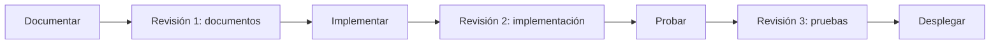
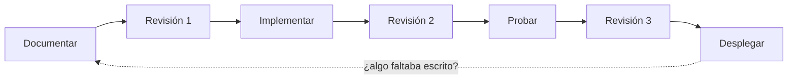

<div align="center">

# Guía del alumno: construir software con un agente

Etapa 3 del curso de Git · AgenticFlow · 1 sesión de 4 horas + autoestudios + proyecto final

<br>


&nbsp;&nbsp;&nbsp;&nbsp;


</div>

---

Esta guía te acompaña durante la sesión: dice qué se hace en cada bloque, cómo se hace cada actividad y qué debes tener listo antes de pasar al siguiente. Si todavía no preparas lo necesario, empieza por los [requisitos previos](requisitos.md).

Hoy van a recorrer **una vez, completo,** el ciclo con el que se construye software de calidad cuando quien escribe el código es un agente:



Lo van a recorrer con algo pequeño, la página del equipo. Al final de la etapa lo recorrerán solos con su propio proyecto, y lo presentarán **construido y desplegado** a ingenieros con experiencia, que les darán mentoría.

**Cómo nos repartimos las herramientas:**

| Herramienta | Para qué la usamos |
|---|---|
| **El agente** | Escribe y ejecuta lo que le pides, con lo que encuentra escrito en el repo |
| **VS Code** | Escribir los documentos y leer lo que cambió |
| **Terminal** (`git`, `gh` y Git Bash) | Trabajar con el ritual de GitFlow y correr las comprobaciones de `pruebas/` |
| **GitHub.com** | Issues, Pull Requests, las tres revisiones y el despliegue |

**Los papeles del equipo:**

| Papel | Qué hace | Lo que nunca hace |
|---|---|---|
| **Piloto** | Tiene el agente funcionando, teclea lo que el equipo decide y lee en voz alta lo que el agente pide y responde | Revisar o probar lo que construyó |
| **Revisor** | Hace la Revisión 1 (documentos) y la Revisión 2 (implementación) con la guía de revisión | Aprobar algo que no puede explicar |
| **Probador** | Prueba lo construido, criterio por criterio, y deja la evidencia en el PR | Creerle al agente sin comprobar |
| **Líder** | Hace la Revisión 3 (pruebas) y despliega | Desplegar algo sin las tres revisiones |

> **La regla que ordena todo:** quien construye no prueba ni aprueba su propio trabajo. Si son tres, el líder es también el probador, y la Revisión 3 la hace el revisor. Los papeles rotan en los autoestudios y en el proyecto final.

**Los bloques de la sesión:**

| # | Bloque | Paso del ciclo | Qué queda al terminar |
|---|---|---|---|
| 1 | Un cocinero sin memoria | Antes del ciclo: los riesgos | La tabla de lo que el agente hizo sin instrucciones y una captura |
| 2 | El recetario de la casa | Documentar | `AGENTS.md` en la rama de documentación |
| 3 | La receta, y la primera revisión | Documentar y Revisión 1 | `ESP-01`, su comprobación, la guía de revisión y la plantilla de PR en `main` |
| ☕ | Descanso | | |
| 4 | El agente implementa, y la segunda revisión | Implementar y Revisión 2 | El PR de la página, revisado |
| 5 | Probar, la tercera revisión y desplegar | Probar, Revisión 3 y Desplegar | La página publicada y comprobada |
| | Cierre: el ciclo completo | | |

---

## <font color="#179287">Cómo usar esta guía</font>

La sesión avanza en **5 bloques** y cada uno abre una pregunta que el siguiente responde. Al final de cada bloque hay una lista **✅ Para seguir adelante**: si puedes marcar todo, estás listo para el siguiente.

Durante toda la sesión, cada vez que el agente diga algo ("listo", "ya pasa", "es responsive"), hazte la misma pregunta: **¿cómo lo sé?** La respuesta siempre es algo que puedes ver: la salida de un comando, un archivo o la página en el navegador. La palabra del agente no cuenta como evidencia.

---

### <font color="#F05032">Bloque 1 — Un cocinero sin memoria *(equipo)*</font>

**Qué es:** en GitFlow, el issue era la **comanda**: nadie cocinaba un platillo sin ella. Hoy llega a la cocina un integrante nuevo, el agente: es brillante y rapidísimo, pero llega cada día sin recordar nada y nunca dice "no sé". En este bloque vas a ver qué hace cuando no le das nada más que una frase, y qué **riesgos** aparecen solos.

**Paso 1 — Ponte al día y abre una rama de experimento** *(piloto, en el repo del equipo)*

```bash
git switch main
git pull
git status                              # debe decir que no hay nada pendiente
git switch -c experimento/sin-contexto  # esta rama nunca sale de tu compu
```

**Paso 2 — Comprueba que el agente lee el repo**

Abre tu agente en la carpeta del repo del equipo y pídele:

> ¿Qué archivos hay en este repositorio y para qué crees que sirve?

Compara su respuesta con el explorador de archivos de VS Code. ¿Mencionó algo que no existe? Es la primera vez que te haces la pregunta del día: ¿cómo lo sé?

---

### 📝 Actividad 1 — La página sin contexto

> **Piloto:** escribe esta frase, sin agregar nada más.

```text
Haz una página web para presentar a nuestro equipo.
```

**Mientras el agente trabaja:**

- Cuando pida permiso para ejecutar un comando o editar un archivo, **léelo en voz alta antes de aceptar**.
- **No elijas "permitir siempre"** ni ningún modo automático. Cada permiso se decide.
- Si pide hacer `git push`, cambiarse a `main` o borrar algo, **recházalo**.

**El resto del equipo** copia esta tabla en un archivo de notas y la llena con lo que ve:

```markdown
| Pregunta | Lo que vimos | Riesgo (tabla del final) |
|---|---|---|
| ¿Qué decidió solo? (tecnología, archivos, colores, contenido) | | |
| ¿Qué inventó? (datos, textos o archivos que no salen del repo) | | |
| ¿Qué comandos pidió ejecutar? | | |
| ¿Qué agregó de fuera? (frameworks, fuentes, paquetes) | | |
| ¿Qué afirmó al terminar? | | |
| De lo que afirmó, ¿qué pudimos comprobar y cómo? | | |
```

Para la tercera columna, busquen cada cosa en los [riesgos de trabajar con un agente](#acordeón-los-riesgos-y-su-momento), al final de esta guía.

---

**Paso 3 — ¿Cómo lo sé?**

1. `git status`: ¿qué archivos creó o cambió? ¿Alguno que no esperabas?
2. Abre la página en el navegador (doble clic en el archivo `.html` que creó). Revisa cada cosa que el agente afirmó.
3. **Toma una captura de pantalla de la página.** La vas a comparar al final de la sesión.

**Paso 4 — Guarda la evidencia y regresa a `main`**

```bash
git add .
git commit -m "experimento: página sin contexto"
git switch main
```

El experimento queda guardado en tu rama local y `main` sigue limpio.

> **Lo que el agente ejecuta, lo firmas tú.** En un proyecto real, los permisos de un agente se fueron acumulando con "permitir siempre" hasta incluir `git push` y `git reset` con cualquier argumento. Nadie lo decidió: se fue aprobando de uno en uno.

**✅ Para seguir adelante**
- [ ] El agente pudo leer los archivos del repo del equipo
- [ ] Llenamos la tabla de la Actividad 1, con la columna de riesgos
- [ ] Tengo la captura de la página sin contexto
- [ ] Estoy de vuelta en `main` y `git status` no muestra nada pendiente

---

### <font color="#F05032">Bloque 2 — El recetario de la casa: `AGENTS.md` *(equipo · Documentar)*</font>

**Qué es:** todo lo que el agente decidió solo en el Bloque 1 lo decidió porque no estaba escrito. `AGENTS.md` es el archivo que el agente lee **cada vez que llega**, antes de hacer nada: el recetario pegado en la pared de la cocina. Lo leen la mayoría de los agentes de código; si el tuyo necesita algo más, está en los [requisitos previos](requisitos.md#42-cómo-instalar-cada-uno).

Como en GitFlow: **la configuración es un archivo**, viaja con el repo y entra por Pull Request como cualquier otro cambio.

**Tres reglas para escribirlo:**

| Regla | Por qué |
|---|---|
| **Es un mapa, no una enciclopedia** | Dice dónde está cada cosa y enlaza. Lo largo va en su propio documento |
| **Todo lo que dice es verdad hoy** | El agente lo obedece. En un proyecto real, el README enlazaba a cuatro documentos que nunca existieron y presumía 38 pruebas cuando había 4 |
| **Una sola fuente** | Si tu agente lee otro archivo, ese archivo solo apunta a `AGENTS.md`. En otro proyecto había cuatro archivos de instrucciones que repetían lo mismo con variaciones |

Así empieza el de **FILEY**, un sistema de la UADY construido con agentes:

> | Dónde | Qué es |
> | --- | --- |
> | `filey/` | El monolito Django real (ADR-0001). [...] |
> | `prototipo/` | Mockup HTML estático. Es la **especificación visual** [...] |
> | `docs/` | Requisitos por dominio, ADRs, planes de pruebas funcionales y evidencia de juntas. |
>
> La arquitectura la mandan `docs/adr/`; los detalles de cómo se construye una pantalla viven en los skills, no aquí.

**Paso 1 — El ritual de siempre** *(piloto; el equipo dicta)*
1. Crea el issue **Documentar la página del equipo** con la plantilla **Tarea** y asígnalo al piloto. Este issue cubre el Bloque 2 y el Bloque 3
2. En la terminal:

```bash
git switch main
git pull
git switch -c feature/[número]-documentacion
```

---

### 📝 Actividad 2 — El `AGENTS.md` del equipo

> Copia la [plantilla de `AGENTS.md`](plantillas/plantilla-AGENTS.md) a la raíz del repo con el nombre `AGENTS.md` y llénala entre todos, sección por sección.

| Sección | De dónde sale |
|---|---|
| **Qué es este repositorio** | Una o dos frases del equipo |
| **Dónde vive cada cosa** | Miren las carpetas del repo. `docs/especificaciones/`, `docs/guias/` y `pruebas/` llegan en el Bloque 3, en esta misma rama |
| **Cómo trabajamos** | Su documento de GitFlow, `docs/soporte/workflow_y_politicas_de_trabajo_colaborativo.md`. Copien solo lo que un agente necesita para no romper sus reglas |
| **Lo que no se toca** y **Lo que nunca se hace** | Lo que el equipo no quiere que el agente haga jamás. La plantilla trae lo mínimo: secretos, dependencias, despliegue e instrucciones escondidas |
| **Cómo se comprueba**, **Antes de pedir revisión** y **Cuándo preguntar** | Déjenlos como en la plantilla y agreguen lo que haga falta |

**Antes de dar una línea por buena, pregúntense: ¿cómo lo sé?** Si nadie puede señalar el archivo o la regla que la respalda, la línea no va.

> Si tu agente necesita otro archivo además de `AGENTS.md` (por ejemplo, si tu equipo ya tenía un `CLAUDE.md`), créalo o ajústalo en este mismo paso con una sola línea que apunte a `AGENTS.md`. Cómo hacerlo con cada agente está en los [requisitos previos](requisitos.md#42-cómo-instalar-cada-uno).

---

**Paso 2 — Entrevista al agente**

Con `AGENTS.md` guardado, pídele al agente:

```text
Lee AGENTS.md. No escribas ni cambies nada. Dime qué preguntas tendrías que
hacernos antes de construir cualquier cosa en este repositorio.
```

Para cada pregunta, decidan:
- si la respuesta es de **todo el repo**, va a `AGENTS.md`, ahora;
- si es de **lo que se va a construir** (colores, contenido de la página), anótenla: va a la especificación en el Bloque 3.

**Paso 3 — Guardar sin integrar todavía**

```bash
git status   # solo debe aparecer AGENTS.md (y el archivo que apunta a él, si tu agente lo necesita)
git add .
git commit -m "docs: agrego AGENTS.md"
git push -u origin feature/[número]-documentacion
```

La rama sube a origin para que no viva solo en una compu, pero todavía no se abre el PR: los documentos se revisan juntos al final del Bloque 3.

**✅ Para seguir adelante**
- [ ] `AGENTS.md` está en la rama `feature/[número]-documentacion`, en origin
- [ ] Si mi agente lee otro archivo, ese archivo solo apunta a `AGENTS.md`
- [ ] Tenemos anotadas las preguntas del agente que van a la especificación

---

### <font color="#F05032">Bloque 3 — La receta, y la primera revisión *(equipo · Documentar y Revisión 1)*</font>

**Qué es:** el agente ya sabe dónde está y cómo trabaja el equipo, pero todavía no sabe **qué** quieren que construya. La comanda de GitFlow decía *qué hay que hacer* y *cuándo está terminado*, y le bastaba a una persona que pregunta. A un cocinero que lo toma todo al pie de la letra hay que darle la **receta**: una especificación que vive en el repo, que el agente lee cada vez y que dice qué tiene que ser verdad al terminar. Y antes de que nadie cocine, alguien revisa la receta.

| | Issue (la comanda) | Especificación (la receta) |
|---|---|---|
| **Dónde vive** | En GitHub, y se cierra | En el repo, y se queda |
| **Qué dice** | "Construir ESP-01" | Qué es, qué decisiones ya están tomadas y cómo se sabe que está terminado |
| **Quién la lee** | El equipo, para repartirse el trabajo | El agente, cada vez que trabaja en eso |

**Dos errores reales que esta receta evita:**
- **Un plan no es una especificación.** En un proyecto, la IA escribió un plan de casi 2,400 líneas con días estimados por fase para migrar la aplicación a otro lenguaje. No se migró ni una línea. Un plan cuenta cómo se piensa pasar el tiempo; una especificación cuenta qué tiene que ser verdad al terminar.
- **Si dos documentos dicen distinto, el agente elige uno sin avisar.** En otro proyecto, el glosario decía que un dato *no* decide cierto cambio y un caso de uso decía que *sí*. Cada hecho se escribe en un solo lugar.

Sigan en la misma rama `feature/[número]-documentacion`.

---

### 📝 Actividad 3 — ESP-01: la página del equipo

> Copia la [plantilla de especificación](plantillas/docs/especificaciones/ESP-00-plantilla.md) a `docs/especificaciones/ESP-00-plantilla.md` (se queda como modelo) y otra vez a `docs/especificaciones/ESP-01-pagina-del-equipo.md`. Llena ESP-01. Este es un punto de partida: lo que está entre corchetes lo decide el equipo, y las preguntas del agente que anotaron en el Bloque 2 van aquí.

```markdown
---
id: ESP-01
estado: aceptada
---

# ESP-01 · La página del equipo

## Qué es
Una página web que presenta a los integrantes del equipo [nombre].

## Para quién
Para quien reciba el enlace: en un minuto debe saber quiénes somos y llegar al perfil de cada quien.

## Qué debe mostrar o hacer
- El nombre del equipo como título.
- Una tarjeta por integrante con los datos de su perfil en `integrantes/`: nombre, carrera, su frase y su foto.
- [Algo más que el equipo decida]

## Decisiones ya tomadas
- Un archivo `index.html` y uno `estilos.css`, los dos en la raíz del repositorio.
- HTML y CSS, sin JavaScript.
- No se descarga nada de otros sitios: sin frameworks ni fuentes externas. La única excepción son las fotos, que vienen de `https://github.com/[usuario].png`.
- Los datos salen de `integrantes/*.md`. La página no inventa ni completa datos que no estén ahí.
- Colores: [los que elija el equipo].

## Criterios de aceptación
1. `index.html` existe en la raíz y se abre en el navegador.
2. El título de la página es el nombre del equipo.
3. Hay exactamente una tarjeta por cada archivo de `integrantes/`, con nombre, carrera, frase y foto.
4. Cada tarjeta enlaza al perfil en GitHub: `https://github.com/[usuario-del-líder]/equipo-[nombre]/blob/main/integrantes/[archivo].md`.
5. No se descarga nada de otros sitios, salvo las fotos de GitHub.
6. Con 360 px de ancho no aparece barra de desplazamiento horizontal.

## Fuera de alcance
- Cambiar los perfiles, el README o cualquier archivo de `docs/`, `pruebas/` o `.github/`.
- Otras páginas, menús, animaciones o JavaScript.

## Cómo se comprueba
    sh pruebas/verificar-sitio.sh   # criterios 1, 3 (un enlace por perfil) y 5

A mano, en el navegador:
- [ ] 2. El título es el nombre del equipo
- [ ] 3. Cada tarjeta tiene nombre, carrera, frase y foto
- [ ] 4. Cada enlace lleva al perfil en GitHub
- [ ] 6. F12 → modo de dispositivo móvil → 360 px de ancho: sin barra horizontal
```

**La prueba de cada criterio:** ¿pueden decir con qué comando o qué mirada sabrían que se cumple? Si no, reescríbanlo. "Que se vea bonita" no es un criterio; "usa los colores #179287 y #F05032", sí.

---

**Paso 1 — La comprobación, antes que la página**
1. Copia [`pruebas/verificar-sitio.sh`](plantillas/pruebas/verificar-sitio.sh) con la misma ruta. Revisa que la barra inferior de VS Code diga **LF**
2. Córrela desde una terminal **Git Bash** (en Windows, flecha junto al **+** de la terminal → **Git Bash**):

```bash
sh pruebas/verificar-sitio.sh
```

Responde en rojo: *"no hay index.html en la raíz del repositorio"*. Es lo correcto: **la comprobación existe antes que la página**. Así nadie la ajusta a lo que salió.

**Paso 2 — Las herramientas de la revisión**
1. Copia la [guía de revisión](plantillas/docs/guias/revision.md) a `docs/guias/revision.md`. Ya viene llena: dice quién hace cada revisión, cuándo y con qué lista. Borra las líneas que mencionan `docs/despliegue.md` y `docs/riesgos.md`: esos documentos todavía no existen y los escriben en los autoestudios
2. Reemplaza `.github/pull_request_template.md` por la [nueva plantilla de PR](plantillas/.github/pull_request_template.md): la de GitFlow, ahora con **Cómo lo comprobé** y el registro de las tres revisiones

**Paso 3 — Abrir el PR de documentos**

```bash
git add .
git commit -m "docs: agrego la especificación ESP-01, su comprobación y la guía de revisión"
git push
gh pr create --web
```

Título: `docs: documentación de la página del equipo (ESP-01)`, con `Closes #[número]`. En la descripción, peguen la salida en rojo de la comprobación: es la evidencia de que existe antes que la página. (La plantilla nueva se estrena en el siguiente PR: GitHub usa la que ya está en `main`.)

---

**Paso 4 — Revisión 1 · Documentos** *(revisor)*

En el PR, pestaña **Files changed** → **Review changes**. Copia en el comentario la lista **Revisión 1 · Documentos** de la guía de revisión y marca cada punto. Lo que no marques, explícalo en una línea.

- Si todo está bien: **Approve**.
- Si algo falla: **Request changes**. El piloto lo corrige en la misma rama, hace push y el revisor vuelve a revisar.

Con la aprobación: **Squash and merge** y limpieza (`git switch main`, `git pull`, `git branch -D feature/[número]-documentacion`).

> **¿Por qué revisar documentos?** Porque un error aquí cuesta una línea. El mismo error, encontrado después en el código, cuesta una vuelta entera del agente; encontrado en producción, cuesta una reversa.

**Paso 5 — La comanda, ahora corta**

Crea el issue **Construir ESP-01** con la plantilla **Tarea**:
- *¿Qué hay que hacer?* Construir ESP-01 (`docs/especificaciones/ESP-01-pagina-del-equipo.md`).
- *¿Cuándo está terminado?* Cuando pasa las Revisiones 2 y 3 de la guía de revisión y está desplegada.

Asígnalo al piloto. La comanda ahora es corta porque la receta ya está en la cocina.

**✅ Para seguir adelante**
- [ ] `AGENTS.md`, `ESP-01`, `pruebas/verificar-sitio.sh`, la guía de revisión y la plantilla de PR están en `main`
- [ ] La Revisión 1 quedó en el PR, con su lista marcada
- [ ] Vi la comprobación en rojo
- [ ] Existe el issue **Construir ESP-01**

---

### ☕ Descanso

---

### <font color="#F05032">Bloque 4 — El agente implementa, y la segunda revisión *(equipo · Implementar y Revisión 2)*</font>

**Qué es:** ya está todo escrito y revisado. Ahora sí, que cocine el agente. Un agente puede escribir en minutos lo que el equipo tardaría días en revisar; por eso la implementación nace en su rama, del tamaño de **una** especificación, y no avanza sin que alguien la revise.

**Paso 1 — El ritual de siempre** *(piloto)*

```bash
git switch main
git pull
git switch -c feature/[número]-pagina-del-equipo
```

**Paso 2 — El plan antes que el código**

```text
Vas a construir ESP-01 (docs/especificaciones/ESP-01-pagina-del-equipo.md)
siguiendo AGENTS.md. Antes de escribir nada, dime tu plan: qué archivos vas a
crear o cambiar y cómo vas a comprobar cada criterio. Espera a que lo aprobemos.
```

Revisen el plan contra la especificación: ¿toca archivos fuera de alcance? ¿Toma alguna decisión que no está escrita?

> **Si tienes que explicarle algo en el chat, probablemente faltaba en el repo.** Lo que dices en el chat se olvida al cerrar la sesión; lo que escribes en la especificación o en `AGENTS.md`, no. Si el plan revela un hueco, corrijan el documento (en un PR aparte, con su Revisión 1) y pídanle que lo vuelva a leer.

**Paso 3 — Que cocine**

```text
Adelante con el plan. Cuando termines, corre la comprobación, revisa tu trabajo
con la Revisión 2 de la guía de revisión y muéstrame las dos cosas.
```

Igual que en el Bloque 1: cada permiso se lee en voz alta y se decide.

**Paso 4 — El primer vistazo del piloto**
1. `git status` y `git diff --stat`: ¿qué tocó? Si cambió algo de `pruebas/`, `integrantes/` o `.github/`, descártalo con `git restore [archivo]` y díselo
2. Si el agente no hizo commits, hazlos tú: `git add .` y `git commit -m "feat: agrego la página del equipo (ESP-01)"`
3. En `docs/especificaciones/ESP-01-pagina-del-equipo.md` cambia `estado: aceptada` por `estado: construida`, y otro commit
4. `git push -u origin feature/[número]-pagina-del-equipo` y `gh pr create --web`. Llena **¿Qué cambia?** y **Especificación**; **Cómo lo comprobé** lo llena el probador en el Bloque 5

---

### 📝 Actividad 4 — Revisión 2 · Implementación *(revisor)*

> En el PR, **Files changed** → **Review changes**. Copia la lista **Revisión 2 · Implementación** de la guía de revisión y márcala.

Lo que más importa en esta revisión:

| Pregunta | Por qué |
|---|---|
| ¿Cabe en una sentada? | En un proyecto real, a un agente se le pidió un sistema completo de una vez: un commit de 15,134 líneas y un PR de 32,759 que **nunca recibió una revisión ni se integró** |
| ¿Solo toca lo que pide la especificación? | El agente tiende a hacer de más. **Fuera de alcance** es tu lista de lo que no debe aparecer |
| ¿Agregó algo de fuera, o algún secreto? | Una dependencia o una contraseña que entra sin que nadie la vea se queda para siempre en la historia |
| ¿Puedo explicar cada archivo? | En ese mismo proyecto, el equipo tuvo que abrir cuatro tareas solo para entender lo que había escrito el agente: *"cualquier colaborador nuevo [...] parte desde cero"*. **Si no lo puedes explicar, no se integra** |

- Si todo está bien: **Comment**, con la lista marcada. La aprobación llega en la Revisión 3.
- Si algo falla: **Request changes**. El piloto se lo pasa al agente nombrando **la regla o el criterio** que no se cumple, no cómo arreglarlo. Push, y el revisor vuelve a revisar.

---

**Si el agente da vueltas** después de dos o tres intentos, **no lo persigan.** En ese mismo proyecto, 19 de los 28 commits que siguieron a la implementación gigante fueron correcciones. Cierren el PR, tiren la rama, mejoren la especificación y vuelvan a empezar:

```bash
git switch main
git branch -D feature/[número]-pagina-del-equipo
```

**✅ Para seguir adelante**
- [ ] El PR de la página está abierto, con la plantilla nueva
- [ ] No toca nada de **Lo que no se toca**
- [ ] La Revisión 2 quedó en el PR, con su lista marcada

---

### <font color="#F05032">Bloque 5 — Probar, la tercera revisión y desplegar *(equipo · Probar, Revisión 3 y Desplegar)*</font>

**Qué es:** el agente dice que terminó y el revisor ya leyó el código. Falta lo más importante: comprobar que lo que se va a servir es lo que se pidió. Lo hace alguien que **no lo construyó**, con evidencia, y solo entonces se despliega.

### 📝 Actividad 5 — Las pruebas *(probador)*

1. Trae la rama del PR a tu compu:

```bash
gh pr checkout [número-del-PR]
```

2. Corre tú la comprobación, en Git Bash: `sh pruebas/verificar-sitio.sh`
3. Abre `index.html` en el navegador y revisa cada criterio de ESP-01
4. Deja esta tabla en un comentario del PR (y su resumen en **Cómo lo comprobé**):

```markdown
| Criterio | ✔ / ✘ | Cómo lo comprobé |
|---|---|---|
| 1. index.html existe y se abre | | `sh pruebas/verificar-sitio.sh` (sección 1) |
| 2. El título es el nombre del equipo | | Navegador |
| 3. Una tarjeta completa por perfil | | Comprobación (sección 2) + navegador contra `integrantes/` |
| 4. Cada enlace lleva al perfil en GitHub | | Clic en cada tarjeta |
| 5. Nada descargado de fuera, salvo las fotos | | Comprobación (sección 4) |
| 6. Sin barra horizontal a 360 px | | F12 → modo de dispositivo móvil |
```

**Si un criterio falla:** el probador lo dice en el PR con su número y lo que vio; el piloto se lo pasa al agente (*"El criterio 3 de ESP-01 no se cumple: la tarjeta de Ana no tiene foto."*); push, el revisor mira el cambio nuevo y el probador vuelve a probar.

---

**Paso 1 — Revisión 3 · Pruebas** *(líder, o el revisor si son tres)*

Con la tabla del probador a la vista: **Review changes** → copia la lista **Revisión 3 · Pruebas** y márcala. Lo esencial: que cada criterio tenga evidencia y que **nadie haya tocado `pruebas/`**. Si todo está bien: **Approve**.

**Paso 2 — Integrar**

**Squash and merge**. El título del PR, `feat: agrego la página del equipo (ESP-01)`, queda escrito en `main`. Limpieza: `git switch main`, `git pull` y `git branch -D` de la rama.

**Paso 3 — Desplegar** *(líder, en GitHub.com)*
1. **Settings → Pages → Build and deployment**: *Source* = **Deploy from a branch**, *Branch* = **main** y **/ (root)** → **Save**
2. En uno o dos minutos aparece la dirección: `https://[usuario-del-líder].github.io/equipo-[nombre]/`
3. **La prueba de humo**, en la dirección publicada: abre sin errores, se ven el título y una tarjeta por integrante, las fotos cargan y los enlaces funcionan
4. Comentario en el PR: *"Desplegado y comprobado en [dirección]"*

> **Desde ahora, cada merge a `main` es un despliegue.** Por eso las tres revisiones pasan *antes* del merge, nunca después.

**Si algo falla en producción:** en el PR integrado, botón **Revert**. GitHub crea un PR que lo deshace: Revisión 3 (que vuelva a funcionar), **Squash and merge** y prueba de humo otra vez. Es el `git revert` de GitFlow, con botón. **Nunca un arreglo directo en `main`.**

**✅ Para seguir adelante**
- [ ] La tabla de pruebas está en el PR, con evidencia de cada criterio
- [ ] La Revisión 3 quedó en el PR, con su lista marcada
- [ ] La página está publicada y pasó la prueba de humo
- [ ] El PR tiene el comentario de despliegue

---

### <font color="#F05032">Cierre — El ciclo completo</font>

Pongan lado a lado la captura del Bloque 1 y la página publicada. El agente es el mismo. Lo que cambió fue todo lo que lo rodeó: lo que encontró escrito y las tres veces que alguien revisó antes de servir.



**GitFlow es lo que pone orden a la velocidad.** Un agente puede escribir en una tarde lo que el equipo revisaría en un mes. Sin un proceso, esa velocidad es caos: en un proyecto real, todo el código entró en 5 commits; en otro, un PR de 32,759 líneas nunca se pudo revisar. Con GitFlow, la misma velocidad es avance:

| Lo que aprendieron en GitFlow | Lo que ordena cuando escribe un agente |
|---|---|
| **Issue** (la comanda) | Una unidad de trabajo del tamaño de una especificación |
| **Rama** | El agente trabaja aislado. Si da vueltas, la rama se tira y `main` ni se entera |
| **Pull Request** | El único lugar por donde entra lo del agente, con sus tres revisiones registradas |
| **Reglas de `main`** | Nadie se salta las revisiones: ni el equipo con prisa, ni el agente |
| **Robot** | Corre las comprobaciones en cada PR, sin cansarse (lo configuran en el Autoestudio 5) |
| **Squash** | Un PR, un commit en `main`: cada cambio del agente lleva a su porqué |
| **Revert** | Deshacer en producción sin reescribir la historia |

**¿Cuánto hay que escribir y revisar?** Como en GitFlow, no hay una sola forma correcta: un experimento de fin de semana necesita menos que un sistema con usuarios. Cada equipo puede ajustar cuánto escribe y qué tan larga es cada lista. Lo que no se negocia es que alguien distinto de quien construyó revise antes de servir.

En GitBasic quedó una pregunta abierta: *¿cómo puedes usar la IA en tu carrera sin perder el protagonismo?* Hoy tiene respuesta: **el protagonismo no está en teclear el código. Está en decidir qué debe ser, en organizar cómo se revisa y en comprobar que lo es, antes de que llegue a nadie.**

**Para terminar la sesión**, el piloto borra el experimento: `git branch -D experimento/sin-contexto`.

**Lo que sigue:**

| Qué | De qué trata |
|---|---|
| [Autoestudio 4](autoestudio-4.md) | Decisiones que el agente no vuelve a discutir (ADR y avisos) y el registro de riesgos del equipo |
| [Autoestudio 5](autoestudio-5.md) | El ciclo completo otra vez, ahora con un robot que prueba, un despliegue documentado y un simulacro de reversa |
| [Proyecto final](proyecto-final.md) | Su propio proyecto, construido y desplegado con el ciclo completo, listo para presentarlo |
| **La siguiente etapa** | Presentar su proyecto desplegado a ingenieros egresados y con experiencia en el sector, que les darán mentoría, consejos y respuestas |
| [Lectura de apoyo](lecturas/documentacion-para-agentes.md) | Lo que enseñan tres proyectos reales construidos con agentes |

---

## <font color="#179287">Acordeón: el ciclo y sus revisiones</font>

| Paso | Quién | Qué queda en el repo o en el PR |
|---|---|---|
| **Documentar** | El equipo (el piloto teclea) | `AGENTS.md`, la especificación y su comprobación, en rojo |
| **Revisión 1 · Documentos** | Alguien que no los escribió | Lista marcada en el PR de documentos, *Approve* |
| **Implementar** | El agente, con el piloto | Un PR del tamaño de una especificación |
| **Revisión 2 · Implementación** | El revisor | Lista marcada en el PR, *Comment* o *Request changes* |
| **Probar** | El probador | Tabla de criterios con evidencia en el PR |
| **Revisión 3 · Pruebas** | Alguien que no construyó ni probó | Lista marcada, *Approve* |
| **Desplegar** | El líder | *Squash and merge*, prueba de humo y comentario de despliegue |

## <font color="#179287">Acordeón: los documentos del agente</font>

| Documento | Responde | Dónde vive | Cuándo se escribe |
|---|---|---|---|
| `AGENTS.md` | ¿Dónde estoy y cómo se trabaja aquí? | Raíz del repo | Antes de que el agente trabaje; crece con cada error |
| Especificación | ¿Qué hay que construir y cuándo está terminado? | `docs/especificaciones/ESP-NN-...md` | Antes de cada cosa que se construye |
| Comprobación | ¿Cómo lo sé? | `pruebas/` | Junto con la especificación, antes de construir |
| Guía de revisión | ¿Quién revisa qué, cuándo y con qué lista? | `docs/guias/revision.md` | Una vez; se ajusta por PR |
| ADR | ¿Por qué se decidió así? | `docs/adr/NNNN-...md` | Cuando una decisión es cara de revertir |
| Aviso "no lo arregles" | ¿Qué parece un error y no lo es? | `AGENTS.md` o la guía del tema | Cuando algo intencional parece un error |
| Guía por tema | ¿Cómo se hace esto aquí? | `docs/guias/...md` | Cuando la misma explicación se repite |
| Registro de riesgos | ¿Qué puede salir mal y cuándo se previene? | `docs/riesgos.md` | Al empezar; crece con cada susto |
| Despliegue | ¿Dónde se publica, cómo se comprueba y cómo se deshace? | `docs/despliegue.md` | Antes del primer despliegue |

## <font color="#179287">Acordeón: los riesgos y su momento</font>

Un riesgo se mitiga en el momento más temprano en que cuesta poco: antes de escribirle no cuesta nada, en un documento cuesta una línea, en una revisión una corrección, en producción una reversa.

| Momento | Riesgo | Cómo se mitiga |
|---|---|---|
| **Antes de escribirle** | Secretos y datos personales en el chat o en el repo | No pegarlos nunca; `.gitignore`; *Lo que nunca se hace* |
| **Al documentar (Revisión 1)** | Inventa datos, archivos o cifras | Documentos que solo dicen la verdad; *Cuándo preguntar* |
| | Decide solo lo que nadie escribió | *Decisiones ya tomadas*; ADR |
| | Hace de más | *Fuera de alcance*; *Lo que no se toca* |
| | Código que funciona pero es inseguro | Criterios de seguridad y privacidad en la especificación |
| **Al pedir** | Trabajo demasiado grande para revisarlo | Una especificación por PR; plan antes del código |
| **Durante la implementación** | Comandos peligrosos | Leer cada permiso; nunca "permitir siempre"; reglas de `main` |
| | Obedece instrucciones escondidas en lo que lee | No darle contenido de fuera de confianza; *Lo que nunca se hace* |
| **Revisión 2** | Dependencias que nadie decidió | Cada dependencia nueva debe estar en un documento |
| | Código que nadie entiende | Si el revisor no lo puede explicar, no se integra |
| **Probar y Revisión 3** | Dice "listo" sin evidencia | El probador corre la comprobación y prueba cada criterio |
| | Debilita o borra pruebas | `pruebas/` no se toca; la Revisión 3 lo revisa |
| **Al desplegar** | Algo roto llega a producción | Tres revisiones antes del merge; prueba de humo; Revert |
| **Después de cada error** | Olvida lo que se le corrigió en el chat | La corrección se escribe en el repo |
| **Todo el ciclo** | El equipo pierde el protagonismo | El equipo decide, revisa y prueba; los papeles rotan |

## <font color="#179287">Acordeón: el ritual con un agente</font>

| Momento | Qué hago | Dónde / comando |
|---|---|---|
| **Antes** | Un issue corto que apunta a una especificación revisada | GitHub.com → Issues |
| | Pararme en la base y ponerme al día | `git switch main` + `git pull` |
| | Abrir mi rama | `git switch -c feature/[número]-[descripción]` |
| | Pedir el plan antes del código | "Antes de escribir nada, dime tu plan" |
| **Durante** | Leer cada permiso antes de aceptarlo | Nada de "permitir siempre" |
| | Si le explico algo en el chat, ¿faltaba en el repo? | Corregir el documento, no solo el chat |
| **Después** | Ver qué tocó | `git status` / `git diff --stat` |
| | Pedir revisión | PR con la plantilla y `Closes #[número]` |
| | Probar la rama de otro | `gh pr checkout [número]` + la comprobación + los criterios |
| | Integrar y desplegar | **Squash and merge** + prueba de humo |
| **Pánico** | El agente da vueltas | Cerrar el PR, tirar la rama y mejorar la especificación |
| | Cambió algo que no debía, sin commit | `git restore [archivo]` |
| | Algo roto en producción | Botón **Revert** del PR → Revisión 3 → merge → prueba de humo |

**Reglas de oro:**

- Lo que no está escrito, el agente lo inventa. Lo que está escrito, lo obedece aunque sea falso.
- La palabra del agente no es evidencia. La salida de un comando, sí.
- Quien construye no prueba ni aprueba su propio trabajo.
- Una especificación por PR. Si no cabe en una sentada, son dos.
- Las comprobaciones no se editan para que pasen.
- Lo que el agente ejecuta, lo firmas tú.
- Cada error del agente que se pudo evitar con una línea se convierte en esa línea.

---

## <font color="#179287">Si algo sale mal</font>

| Problema | Solución |
|---|---|
| El agente no sigue `AGENTS.md` | Pregúntale algo que solo diga ese archivo (*"¿qué carpeta no puedes tocar?"*). Si no lo sabe, no lo está leyendo: revisa el nombre del archivo y lo que dicen los [requisitos previos](requisitos.md#42-cómo-instalar-cada-uno) sobre tu agente |
| `sh: command not found` o `sh` no se reconoce | Estás en PowerShell. Abre una terminal **Git Bash** |
| La comprobación falla con `$'\r': command not found` | El `.sh` se guardó con CRLF. En VS Code, clic en **CRLF** (barra inferior) → **LF**, guardar |
| El agente quiere hacer `git push` o trabajar en `main` | Recházalo. De todas formas, las reglas del repo que configuraron en GitFlow lo impedirían |
| El agente modificó `pruebas/` | Descarta ese cambio (`git restore pruebas/`) y pídele que cumpla el criterio sin tocar la comprobación |
| No puedo aprobar mi propio PR | Es correcto: lo aprueba otra persona del equipo, como en GitFlow |
| `gh pr checkout` dice que tengo cambios sin guardar | Guarda o descarta tus cambios (`git status`) y vuelve a intentarlo |
| La página publicada da 404 | Espera dos minutos y revisa **Settings → Pages**. `index.html` debe estar en la raíz de `main` |
| La publicación falla en la pestaña **Actions** (*pages build and deployment*) | Crea en la raíz un archivo vacío llamado `.nojekyll` y súbelo por PR |
